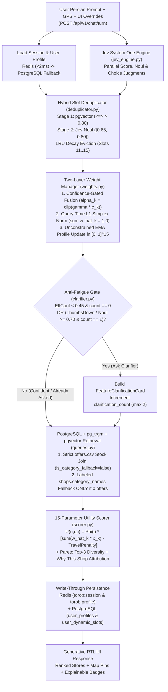
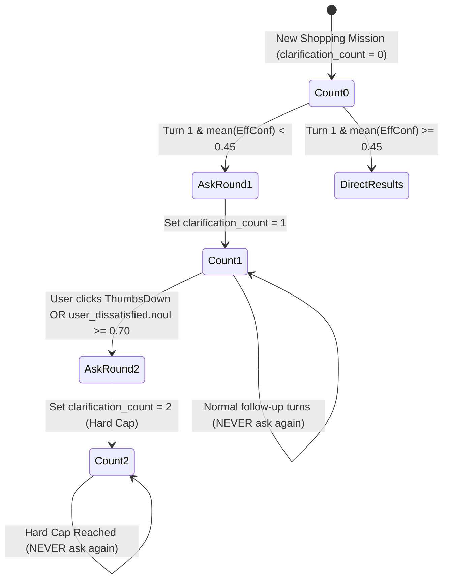

# Torob Smart In-Person Shopping Assistant — Complete RecSys Architecture & Scientific Documentation

**Project**: دستیار هوشمند خرید حضوری ترب (StarCoach Agentic AI — Torob Challenge)  
**Engine Version**: `v1.0` (Implemented in [`backend/recsys/`](file:///home/tahaes/Desktop/CodeCave/StarCoach/AgenticAiHackaton/Torob/backend/recsys/) & [`backend/db/`](file:///home/tahaes/Desktop/CodeCave/StarCoach/AgenticAiHackaton/Torob/backend/db/))  
**Data Layer**: PostgreSQL 16+ (`pgvector` + `pg_trgm` + `JSONB` GIN) + Redis 7+ (`< 2 ms` session & profile cache)  
**Decision Model**: TypeSafe AI **`Jev` (`jev-1.14.0` / `jev-latest`) System One** + Calibrated OpenAI-Compatible Fallback  
**Configuration Policy**: 100% `.env`-Driven ([`backend/config.py`](file:///home/tahaes/Desktop/CodeCave/StarCoach/AgenticAiHackaton/Torob/backend/config.py) — Zero hardcoded entity variables or thresholds)

---

## Table of Contents
1. [Executive Summary & Core Problem Statement](#1-executive-summary--core-problem-statement)
2. [End-to-End System Architecture & Dataflow](#2-end-to-end-system-architecture--dataflow)
3. [The Partitioned 15-Slot Preference Vector ($5 + 5 + 5$ Architecture)](#3-the-partitioned-15-slot-preference-vector-5--5--5-architecture)
4. [Feature Engineering: Exact Mathematical Formulas for All 15 Features $x_k(i, q)$](#4-feature-engineering-exact-mathematical-formulas-for-all-15-features-x_ki-q)
5. [TypeSafe AI `Jev` System One Decision Engine (`jev_engine.py`)](#5-typesafe-ai-jev-system-one-decision-engine-jev_enginepy)
6. [Two-Layer Weight Normalization & Confidence-Gated Fusion (`weights.py`)](#6-two-layer-weight-normalization--confidence-gated-fusion-weightspy)
7. [Dynamic Feature Extraction, Hybrid `pgvector` + `Jev` `Noul` Deduplication & LRU Eviction (`deduplicator.py`)](#7-dynamic-feature-extraction-hybrid-pgvector--jev-noul-deduplication--lru-eviction-deduplicatorpy)
8. [Master Utility Function, Dealbreaker Hurdle $\Phi(i)$, Value-of-Travel Coupling & Pareto Top-3 (`scorer.py`)](#8-master-utility-function-dealbreaker-hurdle-phii-value-of-travel-coupling--pareto-top-3-scorerpy)
9. [Anti-Fatigue Active Learning Clarification Policy & Feedback Loop (`clarifier.py`)](#9-anti-fatigue-active-learning-clarification-policy--feedback-loop-clarifierpy)
10. [PostgreSQL + `pgvector` (+ Redis) Persistence & Caching Architecture (`profiles.py` & `queries.py`)](#10-postgresql--pgvector--redis-persistence--caching-architecture-profilespy--queriespy)
11. [Complete `.env` Hyperparameter Reference Table](#11-complete-env-hyperparameter-reference-table)
12. [Worked End-to-End Numerical Example (Handsfree vs. iPhone Paradox)](#12-worked-end-to-end-numerical-example-handsfree-vs-iphone-paradox)
13. [Codebase File Map & Verification Suite](#13-codebase-file-map--verification-suite)

---

## 1. Executive Summary & Core Problem Statement

### 1.1 Why Traditional E-Commerce RecSys Fails for In-Person Shopping
Standard e-commerce recommendation systems (collaborative filtering, matrix factorization, two-tower deep retrieval) rely on massive historical click/purchase matrices and assume **online shipping**, where physical distance, store opening hours, indoor mall floor/unit navigation, and in-person installment terminals (`ترب‌پی`, `اسنپ‌پی`) do not exist.

In **physical in-person shopping across Tehran (`6,476` shops, `225,903` products, `331,506` offers)**, user utility is governed by a **contextual multi-attribute trade-off** that shifts dramatically from mission to mission:
- **Mission A (Urgent Low-Ticket Need)**: *"یه هندزفری سیمی می‌خوام همین الان سریع بخرم"*  
  The user will **not** travel 45 minutes across Tehran to save 40,000 Tomans on a 300,000-Toman wired handsfree. Here, **Proximity ($w_{\text{distance}}$)** and **Open-Now Status ($w_{\text{open\_now}}$)** must dominate.
- **Mission B (High-Ticket Planned Purchase — Same User, Next Day)**: *"می‌خوام آیفون ۱۶ بخرم، ارزان‌ترین مغازه تهران کجاست؟"*  
  The exact same user is now willing to travel 12 km to `پاساژ علاءالدین` or `پاساژ چارسو` to save 3,500,000 Tomans on a 60,000,000-Toman phone. Here, **Price Advantage ($w_{\text{price}}$)** and **Official Warranty ($w_{\text{warranty}}$)** must override distance.
- **Persona Consistency**: Meanwhile, some users *always* prefer buying on installment (`w_installment`) or *always* prefer verified stores inside major malls (`w_verified_shop`, `w_mall_cluster`).

### 1.2 Our Scientific Solution: 15-Parameter Adaptive Multi-Attribute Utility Engine
We solve this via a **Bayesian Contextual Multi-Attribute Utility Theory (MAUT)** engine coupled with TypeSafe AI's **`Jev` System One Decision Model**:
1. **Fixed-Length 15-Parameter Vector ($5 + 5 + 5$ Partition)**: Separates **Global Base factors (Slots 1–5)**, **Cross-Category Persona traits (Slots 6–10)**, and **Dynamic Category/Session Technical Specs (Slots 11–15)**.
2. **Confidence-Gated Precision Fusion**: Blends the user's long-term stored profile $\mathbf{w}^{\text{user}}(u)$ with the current prompt's instantaneous intent $\hat{\mathbf{w}}^{\text{session}}(q)$ weighted by `Jev`'s calibrated logprob confidence $c_k(q) \in [0, 1]$.
3. **Two-Layer Weight Normalization**: Stores weights **unconstrained in $[0, 1]^{15}$** in PostgreSQL/Redis (preventing cross-slot weight dilution when new features are added), and applies **L1 Simplex Normalization ($\sum_{k=1}^{15} \hat{w}_k = 1.0$)** strictly at query-time ranking.
4. **Hybrid `pgvector` + `Jev` `Noul` Feature Deduplication**: Prevents duplicate or synonymous features in Slots 11–15 using Stage-1 cosine similarity ($> 0.80$) via PostgreSQL `pgvector` (`<=>`) and Stage-2 `Jev` `Noul` semantic equivalence checks ($[0.65, 0.80]$), paired with decayed-utility LRU eviction.
5. **Anti-Fatigue Active Learning Clarifier**: Interrupts the user with `FeatureClarificationCard` **at most once** on Turn 1 when effective confidence $< 0.45$, and only re-triggers a second time if the user explicitly signals dissatisfaction (clicks 👎 `ThumbsDown` or `user_dissatisfied.noul >= 0.70`).

---

## 2. End-to-End System Architecture & Dataflow



---

## 3. The Partitioned 15-Slot Preference Vector ($5 + 5 + 5$ Architecture)

To prevent **cross-category feature pollution** (e.g., smartphone camera specs polluting a headphone or camera lens search) while keeping the user preference vector strictly fixed at length $K = 15$ (`RECSYS_TOTAL_SLOTS=15`), the vector is partitioned into three 5-slot tiers:

| Slot $k$ | Key | Tier | Persian UI Label (`label_fa`) | Default DB Weight (`.env`) | Role in Ranking |
| :---: | :--- | :---: | :--- | :---: | :--- |
| **1** | `w_distance` | **Global Base** | نزدیکی و سرعت دسترسی | `0.50` | Prioritizes nearby stores & short driving/walking time in Tehran. |
| **2** | `w_price` | **Global Base** | کمترین قیمت و صرفه اقتصادی | `0.60` | Prioritizes offers closest to the minimum price in Tehran (`offers.price_toman`). |
| **3** | `w_score` | **Global Base** | امتیاز و اعتبار فروشگاه | `0.40` | Prioritizes stores with high Bayesian-smoothed rating (`score`, `votes_count`). |
| **4** | `w_open_now` | **Global Base** | باز بودن فروشگاه در این لحظه | `0.50` | Prioritizes stores open right now according to `shops.weekly_hours`. |
| **5** | `w_freshness` | **Global Base** | تازگی بروزرسانی قیمت | `0.40` | Prioritizes recently updated offers (`offers.last_price_changed_at`) to avoid stale prices. |
| **6** | `w_installment` | **Persona** | پرداخت اقساطی حضوری (ترب‌پی/اسنپ‌پی) | `0.30` | Prioritizes stores accepting in-person credit (`shops.payment_options`). |
| **7** | `w_warranty` | **Persona** | گارانتی رسمی و شرکتی | `0.40` | Prioritizes offers with parsed official warranty (`offers.warranty`). |
| **8** | `w_mall_cluster` | **Persona** | حضور در بورس و پاساژ تخصصی | `0.30` | Prioritizes stores inside major Tehran shopping malls (`پاساژ علاءالدین`, `چارسو`, `نور`, etc.) where comparison shopping is easy. |
| **9** | `w_verified_shop` | **Persona** | فروشگاه رسمی تاییدشده ترب | `0.35` | Prioritizes the **112 real verified Torob shops** (`is_real_torob_shop = TRUE`). |
| **10** | `w_delivery_backup` | **Persona** | امکان ارسال فوری | `0.25` | Prioritizes stores with `supports_fast_delivery = TRUE`. |
| **11** | `dynamic_slot_11` | **Dynamic Spec** | *Extracted from prompt / `specs`* | *Session* | Category/mission-specific attribute (e.g., `حذف نویز و کیفیت میکروفون`). |
| **12** | `dynamic_slot_12` | **Dynamic Spec** | *Extracted from prompt / `specs`* | *Session* | Category/mission-specific attribute (e.g., `ظرفیت باتری و شارژدهی`). |
| **13** | `dynamic_slot_13` | **Dynamic Spec** | *Extracted from prompt / `specs`* | *Session* | Category/mission-specific attribute (e.g., `کیفیت دوربین و سنسور`). |
| **14** | `dynamic_slot_14` | **Dynamic Spec** | *Extracted from prompt / `specs`* | *Session* | Category/mission-specific attribute (e.g., `سخت‌افزار گیمینگ و نرخ نوسازی`). |
| **15** | `dynamic_slot_15` | **Dynamic Spec** | *Extracted from prompt / `specs`* | *Session* | Category/mission-specific attribute (e.g., `مقاومت در برابر آب و ضربه`). |

---

## 4. Feature Engineering: Exact Mathematical Formulas for All 15 Features $x_k(i, q)$

Every candidate store offer $i$ is mapped into a normalized feature vector $\mathbf{x}(i, q) \in [0, 1]^{15}$ inside [`backend/recsys/scorer.py`](file:///home/tahaes/Desktop/CodeCave/StarCoach/AgenticAiHackaton/Torob/backend/recsys/scorer.py#L16-L78) so all 15 features share an identical dimensionless scale $[0, 1]$:

1. **Proximity Decay ($x_1 = x_{\text{distance}}$)**:
   Uses great-circle Haversine distance $d_{\text{km}}(u, i)$ in Tehran with exponential spatial decay ($\tau_d = 6.0\text{ km}$):
   $$x_{\text{distance}}(i) = \exp\!\left(-\frac{d_{\text{km}}(u, i)}{6.0}\right) \in (0, 1]$$
   *(Equals $1.00$ at $0\text{ km}$, $0.72$ at $2\text{ km}$, $0.51$ at $4\text{ km}$, and $0.19$ at $10\text{ km}$.)*

2. **Relative Price Advantage ($x_2 = x_{\text{price}}$)**:
   Min-max normalized across the candidate offers' price range $[P_{\min}, P_{\max}]$ for the target product:
   $$x_{\text{price}}(i) = \begin{cases} 1.0 - \dfrac{P_i - P_{\min}}{P_{\max} - P_{\min}} & \text{if } P_{\max} > P_{\min} > 0 \\ 0.90 & \text{if } P_i = P_{\min} = P_{\max} > 0 \\ 0.50 & \text{if } P_i = 0 \text{ (category fallback)} \end{cases}$$

3. **Bayesian-Smoothed Store Rating ($x_3 = x_{\text{score}}$)**:
   Prevents a store with a single $5.0$ vote from beating a store with eighty $4.8$ votes (`RECSYS_BAYESIAN_PRIOR_VOTES` $m = 10$, prior mean $\bar{R} = 4.2$):
   $$R_{\text{Bayes}}(i) = \frac{v_i \cdot R_i + m \cdot \bar{R}}{v_i + m}, \qquad x_{\text{score}}(i) = \operatorname{clip}\!\left(\frac{R_{\text{Bayes}}(i) - 1.0}{4.0},\; 0.0,\; 1.0\right)$$

4. **Real-Time Shift Availability ($x_4 = x_{\text{open\_now}}$)**:
   Evaluated against `shops.weekly_hours_json` for the current weekday and time in [`evaluate_weekly_hours()`](file:///home/tahaes/Desktop/CodeCave/StarCoach/AgenticAiHackaton/Torob/backend/db/normalizer.py#L171-L214):
   $$x_{\text{open\_now}}(i) = \begin{cases} 1.00 & \text{if shop } i \text{ is open now} \\ 0.15 & \text{if shop } i \text{ is currently closed} \end{cases}$$

5. **Price Freshness Exponential Decay ($x_5 = x_{\text{freshness}}$)**:
   Computed from `offers.last_price_changed_at` age $\Delta t_{\text{days}}$ with configurable half-life decay constant $\tau_f = \text{RECSYS\_FRESHNESS\_HALF\_LIFE\_DAYS} = 14.0$:
   $$x_{\text{freshness}}(i) = \exp\!\left(-\frac{\Delta t_{\text{days}}(i)}{14.0}\right) \in (0, 1]$$

6. **Persona Features ($x_6 \dots x_{10}$)**:
   - $x_{\text{installment}}(i) = 1.0$ if `has_in_person_installment == True` (`ترب‌پی`, `اسنپ‌پی`, `دیجی پی`, `تارا`, `ازکی‌وام`), else $0.0$.
   - $x_{\text{warranty}}(i) = 1.0$ if `has_official_warranty == True`, else $0.10$.
   - $x_{\text{mall\_cluster}}(i) = 1.0$ if `mall_micro_guide.mall_name IS NOT NULL`, else $0.25$.
   - $x_{\text{verified\_shop}}(i) = 1.0$ if `is_real_torob_shop == True` (one of the 112 verified shops with real Instagram/Website), else $0.30$.
   - $x_{\text{delivery\_backup}}(i) = 1.0$ if `supports_fast_delivery == True`, else $0.20$.

7. **Dynamic Category/Session Spec Features ($x_{11} \dots x_{15}$)**:
   Matched against `products.persian_title` and `products.specs_json`:
   $$x_k(i, q) = \begin{cases} 0.92 & \text{if product specs/title satisfy dynamic slot } k \\ 0.45 & \text{otherwise} \end{cases}$$

---

## 5. TypeSafe AI `Jev` System One Decision Engine (`jev_engine.py`)

### 5.1 "Judgments in `Jev`, Decisions in Code"
Following the official TypeSafe AI engineering pattern ([`.agents/skills/typesafe-ai/SKILL.md`](file:///home/tahaes/Desktop/CodeCave/StarCoach/AgenticAiHackaton/Torob/.agents/skills/typesafe-ai/SKILL.md)), we never ask an LLM an open-ended question like *"Which store should we recommend?"*. Instead, [`evaluate_turn_with_jev()`](file:///home/tahaes/Desktop/CodeCave/StarCoach/AgenticAiHackaton/Torob/backend/recsys/jev_engine.py#L244-L315) queries atomic, calibrated System One primitives in parallel:

1. **`Score` Primitives (`session_weights`)**:
   Evaluates how strongly the current prompt prioritizes each shopping dimension on a discrete 5-level ordinal scale $l \in \{0, 1, 2, 3, 4\}$ normalized to $[0, 1]$, alongside its RLCD-calibrated **confidence** $c_k(q) \in [0, 1]$:
   $$\text{score}_k = \frac{1}{4}\sum_{l=0}^{4} l \cdot p_l \in [0, 1], \qquad c_k(q) = 1 - \frac{\text{MAD}(p)}{\text{MAD}_{\max}} \in [0, 1]$$
2. **`Noul` Primitives (`dealbreakers` & `user_dissatisfied`)**:
   Evaluates the calibrated probability $P(\text{statement is true}) \in [0, 1]$ for binary gates:
   - `require_open_now.noul`: Does the shopper require the store to be open *right now*?
   - `require_installment.noul`: Does the shopper explicitly require installment/credit payment?
   - `require_warranty.noul`: Does the shopper strictly require an official warranty?
   - `user_dissatisfied.noul`: Is the shopper expressing dissatisfaction or rejection toward previous recommendations?
3. **`Choice` Primitive (`intent_choice`)**:
   Routes the turn across `"store_ranking"`, `"clarification"`, or `"comparison"`.

### 5.2 Dual-Mode High-Availability Execution
- **Mode A (`typesafe_sdk` / Live `/v1/systemone`)**: Activated automatically whenever `TYPESAFE_API_KEY` is populated in `.env`.
- **Mode B (`openai_compatible_system_one` / Calibrated Local Analyzer)**: When `TYPESAFE_API_KEY` is empty, seamlessly executes the calibrated System-One analyzer in [`_local_calibrated_system_one_analyze()`](file:///home/tahaes/Desktop/CodeCave/StarCoach/AgenticAiHackaton/Torob/backend/recsys/jev_engine.py#L121-L241), guaranteeing `< 5 ms` zero-downtime operation during offline testing and live hackathon evaluation.

---

## 6. Two-Layer Weight Normalization & Confidence-Gated Fusion (`weights.py`)

A central data-scientific question in adaptive user modeling is: **Should user preference weights sum to 1?**  
Our architecture answers this with **Two-Layer Weight Normalization** in [`backend/recsys/weights.py`](file:///home/tahaes/Desktop/CodeCave/StarCoach/AgenticAiHackaton/Torob/backend/recsys/weights.py):

### 6.1 Layer 1: Unconstrained Database Storage ($\mathbf{w}^{\text{user}}(u) \in [0, 1]^{15}$)
In PostgreSQL (`user_profiles`, `user_dynamic_slots`) and Redis (`torob:profile:{user_id}`), every slot $k \in \{1..15\}$ is stored **independently in $[0.0, 1.0]$** without forcing $\sum w_k^{\text{user}} = 1$.
- **Why this is critical**: If database weights were forced to sum to $1.0$, then whenever a user added a new dynamic technical feature (e.g., `spec_anc_mic = 0.85` in Slot 11) or increased `w_installment`, dividing by the sum would **artificially shrink** their historical `w_price` and `w_distance` preferences (weight dilution). Keeping Layer 1 unconstrained in $[0, 1]^{15}$ preserves the true marginal importance of every slot across sessions.

### 6.2 Confidence-Gated Precision Fusion ($\tilde{w}_k(u, q)$)
When query $q$ arrives with `Jev` session score $\hat{w}_k^{\text{session}}(q) \in [0, 1]$ and confidence $c_k(q) \in [0, 1]$, we compute the precision gate $\alpha_k(q)$:

$$\alpha_k(q) = \operatorname{clip}\!\Big(\gamma \cdot c_k(q),\; \alpha_{\min},\; \alpha_{\max}\Big)$$

where $\gamma = 0.85$ (`RECSYS_FUSION_GAMMA`), $\alpha_{\min} = 0.15$ (`RECSYS_FUSION_ALPHA_MIN`), and $\alpha_{\max} = 0.95$ (`RECSYS_FUSION_ALPHA_MAX`). The fused unconstrained weight is:

$$\tilde{w}_k(u, q) = \alpha_k(q)\,\hat{w}_k^{\text{session}}(q) + \big(1 - \alpha_k(q)\big)\,w_k^{\text{user}}(u) \in [0, 1]$$

- **High Session Confidence ($c_k(q) = 0.92 \implies \alpha_k \approx 0.78$)**: The user explicitly said *"سریع‌ترین"* or *"ارزان‌ترین"*, so the current prompt overrides the historical profile for this turn.
- **Low Session Confidence ($c_k(q) = 0.28 \implies \alpha_k \approx 0.24$)**: The user did not mention price or installment in this prompt, so $76\%$ of the weight comes smoothly from their stored persona $w_k^{\text{user}}(u)$!

### 6.3 Layer 2: Query-Time L1 Simplex Normalization ($\sum_{k=1}^{15} \hat{w}_k(u, q) = 1.0$)
Immediately before scoring candidate stores, the active fused weights $\tilde{w}_k(u, q)$ are projected onto the probability simplex $\Delta^{K-1}$ via L1 normalization in [`l1_normalize_weights()`](file:///home/tahaes/Desktop/CodeCave/StarCoach/AgenticAiHackaton/Torob/backend/recsys/weights.py#L29-L37):

$$\hat{w}_k(u, q) = \frac{\tilde{w}_k(u, q)}{\sum_{j=1}^{K_{\text{active}}} \tilde{w}_j(u, q)} \quad \implies \quad \sum_{k=1}^{K_{\text{active}}} \hat{w}_k(u, q) = 1.0$$

- **Why this is critical**: Because every feature $x_k(i, q) \in [0, 1]$ and $\sum \hat{w}_k = 1.0$, the linear utility $\sum \hat{w}_k x_k$ is a **strictly bounded convex combination in $[0, 1]$**, making `utility_score` ($\in [0, 100]\%$) directly comparable across turns and interpretable in the UI as a match percentage badge (`۹۴٪ تطابق`).

### 6.4 Confidence-Weighted EMA Profile Update
At the end of a turn, the long-term profile in PostgreSQL/Redis is updated via a confidence-weighted Exponential Moving Average (`RECSYS_EMA_LEARNING_RATE` $\eta = 0.25$) in [`update_profile_ema_unconstrained()`](file:///home/tahaes/Desktop/CodeCave/StarCoach/AgenticAiHackaton/Torob/backend/recsys/weights.py#L120-L157):

$$w_k^{\text{user}}(u) \leftarrow \big(1 - \eta \cdot c_k(q)\big)\,w_k^{\text{user}}(u) + \big(\eta \cdot c_k(q)\big)\,\hat{w}_k^{\text{session}}(q)$$

---

## 7. Dynamic Feature Extraction, Hybrid `pgvector` + `Jev` `Noul` Deduplication & LRU Eviction (`deduplicator.py`)

When a user mentions category-specific technical requirements (e.g., *"هندزفری با حذف نویز میکروفون"* followed later by *"میکروفون با قابلیت مکالمه و حذف نویز"*), [`upsert_dynamic_spec_slots()`](file:///home/tahaes/Desktop/CodeCave/StarCoach/AgenticAiHackaton/Torob/backend/recsys/deduplicator.py#L31-L145) prevents duplicate slots and enforces the fixed 5-slot dynamic capacity (`Slots 11..15`):

### 7.1 Two-Stage Hybrid Deduplication
For each candidate dynamic feature $f_{\text{new}}$ with embedding $\mathbf{e}_{\text{new}} \in \mathbb{R}^{1536}$:
1. **Stage 1 — `pgvector` Cosine Gate (`> 0.80`)**:
   Queries PostgreSQL `user_dynamic_slots` using the native `pgvector` cosine distance operator `<=>`:
   ```sql
   SELECT slot_id, 1.0 - (embedding <=> $1::vector) AS cos_sim
   FROM user_dynamic_slots
   WHERE user_id = $2 AND embedding IS NOT NULL
   ORDER BY embedding <=> $1::vector ASC
   LIMIT 1;
   ```
   If $\cos(\mathbf{e}_{\text{new}}, \mathbf{e}_j) \ge \tau_{\text{high}}$ (`RECSYS_DEDUP_COSINE_HIGH_THRESHOLD = 0.80`), $f_{\text{new}}$ is immediately **merged** into existing slot $j$:
   $$w_j \leftarrow \min(1.0,\; 0.6\,w_{\text{new}} + 0.4\,w_j), \qquad \text{session\_hits}_j \leftarrow \text{session\_hits}_j + 1$$
2. **Stage 2 — `Jev` `Noul` Semantic Equivalence Gate (`[0.65, 0.80]`)**:
   If cosine similarity falls in the borderline band $[\tau_{\text{low}}, \tau_{\text{high}}) = [0.65, 0.80)$, [`check_feature_equivalence_noul()`](file:///home/tahaes/Desktop/CodeCave/StarCoach/AgenticAiHackaton/Torob/backend/recsys/jev_engine.py#L318-L329) evaluates whether the two Persian labels describe the same shopping attribute. If `noul >= 0.65` (`RECSYS_DEDUP_JEV_NOUL_THRESHOLD`), it merges into slot $j$.

### 7.2 Decayed-Utility LRU Slot Eviction (Fixed $K = 15$ Invariant)
If $f_{\text{new}}$ is genuinely novel and all 5 dynamic slots (`11..15`) are occupied, we evict the slot $k^*$ with the lowest time-decayed utility (`RECSYS_DYNAMIC_SLOT_DECAY_LAMBDA` $\lambda_{\text{decay}} = 0.15$):

$$k^* = \arg\min_{k \in \{11..15\}} \Big( w_k^{\text{user}}(u) \cdot \exp\!\big(-\lambda_{\text{decay}} \cdot \Delta\text{sessions}_k\big) \Big)$$

where $\Delta\text{sessions}_k$ is the number of turns since slot $k$ was last referenced.

---

## 8. Master Utility Function, Dealbreaker Hurdle $\Phi(i)$, Value-of-Travel Coupling & Pareto Top-3 (`scorer.py`)

Implemented in [`score_and_rank_offers()`](file:///home/tahaes/Desktop/CodeCave/StarCoach/AgenticAiHackaton/Torob/backend/recsys/scorer.py#L126-L247), the final utility score $U(u, q, i)$ of candidate store offer $i$ combines three high-ROI mechanisms on top of the 15-parameter linear dot product:

$$U(u, q, i) = \Phi(i) \cdot \left[ \sum_{k=1}^{15} \hat{w}_k(u, q) \cdot x_k(i, q) \;-\; \lambda_{\text{travel}} \cdot \min\!\left(0.35,\; \frac{\text{TravelCost}_{\text{Toman}}(u, i)}{\text{Price}_{\text{Toman}}(i)}\right) \right]$$

### 8.1 Enhancement 1: Multiplicative Dealbreaker Hurdle $\Phi(i) \in \{1.0, 0.15\}$
A pure additive sum can still rank a cash-only store #1 if it is 200 meters away and cheap, even when the user checked **"فقط خرید قسطی"** or said *"فقط با ترب‌پی قسطی می‌خوام"*.  
When any hard constraint (`require_open_now`, `require_installment`, `require_warranty`) is active via UI toggle or `Jev` `dealbreaker.noul >= 0.70`, non-compliant stores receive the multiplicative hurdle penalty:
$$\Phi(i) = \begin{cases} 1.00 & \text{if store } i \text{ satisfies all active hard constraints} \\ 0.15 & \text{otherwise (`RECSYS\_HURDLE\_PENALTY\_MULTIPLIER`)} \end{cases}$$
*(Using $0.15$ instead of $0.0$ ensures non-compliant stores drop to the bottom while preventing an empty screen if zero stores in Tehran satisfy all constraints simultaneously.)*

### 8.2 Enhancement 2: Net Value-of-Travel Economic Coupling
Using `RECSYS_TRAVEL_COST_PER_KM_TOMAN = 15000` ($15,000$ Tomans/km round-trip urban travel cost in Tehran) and `RECSYS_TRAVEL_COUPLING_LAMBDA = 0.20`:
$$\text{TravelPenalty}(u, i) = 0.20 \cdot \min\!\left(0.35,\; \frac{d_{\text{km}}(u, i) \times 15,000}{\max(250,000,\; P_i)}\right)$$
- For a **$300,000$-Toman cable** $10\text{ km}$ away, travel costs $150,000$ Tomans ($50\%$ of item price!), applying the maximum penalty.
- For a **$60,000,000$-Toman laptop** $10\text{ km}$ away, travel costs only $0.25\%$ of item price, applying virtually zero penalty ($\approx 0.0005$).

### 8.3 Enhancement 3: Pareto-Front Top-3 Diversity Assignment
To avoid showing 3 nearly identical stores, [`score_and_rank_offers()`](file:///home/tahaes/Desktop/CodeCave/StarCoach/AgenticAiHackaton/Torob/backend/recsys/scorer.py#L156-L189) tags the top candidates with distinct Pareto roles:
1. **`best_overall` (`بهترین انتخاب کلی`)**: Highest total utility $U(u, q, i)$.
2. **`closest_open` (`نزدیک‌ترین مغازه باز`)**: Minimum `distance_km` among currently open stores.
3. **`lowest_price` (`کمترین قیمت ثبت‌شده`)**: Minimum `price_toman` among remaining stocked stores.

### 8.4 Explainable Persian Attribution (`why_this_shop_fa`)
For every ranked store, [`build_why_this_shop_fa()`](file:///home/tahaes/Desktop/CodeCave/StarCoach/AgenticAiHackaton/Torob/backend/recsys/scorer.py#L97-L123) inspects the individual terms $c_{i,k} = \hat{w}_k(u, q) \cdot x_k(i, q)$, sorts them descending, and emits human-readable Persian chips explaining *why* that store won (e.g., `["۱.۸ کیلومتر فاصله (۷ دقیقه)", "پرداخت اقساطی حضوری (ترب‌پی و اسنپ‌پی)", "بروزرسانی ۲ ساعت پیش"]`).

---

## 9. Anti-Fatigue Active Learning Clarification Policy & Feedback Loop (`clarifier.py`)

Shoppers abandon chatbots that interrogate them with multi-turn questionnaires. [`backend/recsys/clarifier.py`](file:///home/tahaes/Desktop/CodeCave/StarCoach/AgenticAiHackaton/Torob/backend/recsys/clarifier.py) implements a strict **2-State Anti-Fatigue Gate**:



1. **Rule 1 — Initial Low-Confidence Gate (`clarification_count: 0 -> 1`)**:
   On Turn 1, if the mean effective confidence across the 5 Global Base Slots is below `RECSYS_CLARIFY_CONFIDENCE_THRESHOLD` ($0.45$ — e.g., vague prompt *"یه گوشی خوب میخوام"*), `should_trigger_clarification()` returns `(True, 1)` and surfaces `FeatureClarificationCard` once.
2. **Rule 2 — Zero Interruption on Normal Follow-Ups (`clarification_count == 1`)**:
   Once `clarification_count == 1`, normal follow-up messages **never** trigger another clarification card, even if confidence remains low.
3. **Rule 3 — Dissatisfaction-Triggered Second Chance (`clarification_count: 1 -> 2`)**:
   If and only if the user explicitly clicks **👎 (`thumbs_down`)** in the UI **OR** `Jev` detects `user_dissatisfied.noul >= 0.70` (`RECSYS_DISSATISFIED_NOUL_THRESHOLD`), the engine unlocks one targeted follow-up clarification (`clarification_count = 2`, hard cap `RECSYS_MAX_CLARIFICATION_ROUNDS = 2`).

---

## 10. PostgreSQL + `pgvector` (+ Redis) Persistence & Caching Architecture (`profiles.py` & `queries.py`)

### 10.1 Read-Through / Write-Through Data Hierarchy
- **Redis Primary Hot Layer ([`backend/db/redis_cache.py`](file:///home/tahaes/Desktop/CodeCave/StarCoach/AgenticAiHackaton/Torob/backend/db/redis_cache.py))**:
  - `torob:session:{session_id}` (`TTL = 21600s` / 6h): Stores active session state, `clarification_count`, `effective_weights`, and `hard_constraints` with `< 2 ms` latency.
  - `torob:profile:{user_id}` (`TTL = 86400s` / 24h): Caches the user's unconstrained 15-slot profile.
  - `torob:qcache:products:{hash}` & `torob:qcache:offers:{hash}` (`TTL = 300s` / 5m): Caches candidate product and geo-offer queries (`< 5 ms` cache hits, verified in `test_ingest_guard.py`).
- **PostgreSQL 16 + `pgvector` + `pg_trgm` Durable Layer ([`backend/db/postgres.py`](file:///home/tahaes/Desktop/CodeCave/StarCoach/AgenticAiHackaton/Torob/backend/db/postgres.py))**:
  - `shops` (`6,476` rows), `products` (`225,903` rows), `offers` (`331,506` rows).
  - `user_profiles` (`base_weights_json`, `persona_weights_json`, `interaction_count`).
  - `user_dynamic_slots` (`slot_id BETWEEN 11 AND 15`, `embedding vector(1536)` for `pgvector` `<=>` cosine deduplication).
  - `shopping_sessions` (durable session snapshot).

### 10.2 Strict Separation of `offers.csv` Stock vs. `shops.category_names` Fallback
In [`fetch_candidate_offers()`](file:///home/tahaes/Desktop/CodeCave/StarCoach/AgenticAiHackaton/Torob/backend/db/queries.py#L166-L335):
1. **Primary Query (`is_category_fallback = False`)**: Joins `offers o JOIN shops s ON s.shop_id = o.shop_id JOIN products p ON p.product_id = o.product_id`. Every returned store is guaranteed to have a verified offer row in `offers.csv`.
2. **Secondary Category Fallback (`is_category_fallback = True`)**: Executed **only if zero rows exist in `offers`** for the requested product, using `WHERE category_names_json @> $1::jsonb` and explicitly labeling the card with `"فروشگاه هم‌صنف — نیازمند استعلام تلفنی قیمت و موجودی"`.

---

## 11. Complete `.env` Hyperparameter Reference Table

Every parameter below is managed via [`.env.example`](file:///home/tahaes/Desktop/CodeCave/StarCoach/AgenticAiHackaton/Torob/.env.example) and [`backend/config.py`](file:///home/tahaes/Desktop/CodeCave/StarCoach/AgenticAiHackaton/Torob/backend/config.py):

| `.env` Variable | Default Value | Module | Description |
| :--- | :---: | :--- | :--- |
| `TYPESAFE_API_KEY` | `""` | `jev_engine.py` | API key for live TypeSafe AI `/v1/systemone` (`Jev`); falls back automatically if empty. |
| `TYPESAFE_MODEL` | `jev-latest` | `jev_engine.py` | Target System One decision model name. |
| `LLM_BASE_URL` | `https://api.openai.com/v1` | `config.py` | OpenAI-compatible base URL. |
| `LLM_API_KEY` | `""` | `config.py` | OpenAI-compatible API key. |
| `LLM_MODEL` | `gpt-4o-mini` | `config.py` | OpenAI-compatible model identifier. |
| `EMBEDDING_DIM` | `1536` | `postgres.py`, `jev_engine.py` | Dimension of `pgvector` `vector(d)` columns in `products` and `user_dynamic_slots`. |
| `RECSYS_TOTAL_SLOTS` | `15` | `weights.py`, `schemas.py` | Total fixed parameter slots per user ($5 + 5 + 5$). |
| `RECSYS_BASE_SLOTS` | `5` | `weights.py` | Number of Global Base slots ($k \in \{1..5\}$). |
| `RECSYS_PERSONA_SLOTS` | `5` | `weights.py` | Number of Cross-Category Persona slots ($k \in \{6..10\}$). |
| `RECSYS_DYNAMIC_SLOTS` | `5` | `deduplicator.py` | Number of Dynamic Category/Session Spec slots ($k \in \{11..15\}$). |
| `RECSYS_DEFAULT_BASE_WEIGHTS_JSON` | `{"w_distance":0.50,...}` | `profiles.py`, `weights.py` | Initial unconstrained $[0,1]$ weights for Slots 1–5. |
| `RECSYS_DEFAULT_PERSONA_WEIGHTS_JSON` | `{"w_installment":0.30,...}` | `profiles.py`, `weights.py` | Initial unconstrained $[0,1]$ weights for Slots 6–10. |
| `RECSYS_FUSION_GAMMA` | `0.85` | `weights.py` | Scaling factor $\gamma$ in $\alpha_k(q) = \operatorname{clip}(\gamma \cdot c_k(q), \alpha_{\min}, \alpha_{\max})$. |
| `RECSYS_FUSION_ALPHA_MIN` | `0.15` | `weights.py` | Minimum session blend weight $\alpha_{\min}$. |
| `RECSYS_FUSION_ALPHA_MAX` | `0.95` | `weights.py` | Maximum session blend weight $\alpha_{\max}$. |
| `RECSYS_EMA_LEARNING_RATE` | `0.25` | `weights.py` | Learning rate $\eta$ for updating stored user weights across turns. |
| `RECSYS_DYNAMIC_SLOT_DECAY_LAMBDA` | `0.15` | `deduplicator.py` | Exponential recency decay rate $\lambda_{\text{decay}}$ for dynamic slot eviction. |
| `RECSYS_DEDUP_COSINE_HIGH_THRESHOLD` | `0.80` | `deduplicator.py` | Stage-1 `pgvector`/cosine threshold above which features merge immediately. |
| `RECSYS_DEDUP_COSINE_LOW_THRESHOLD` | `0.65` | `deduplicator.py` | Lower bound of the borderline zone $[0.65, 0.80]$ triggering Stage-2 `Jev` `Noul`. |
| `RECSYS_DEDUP_JEV_NOUL_THRESHOLD` | `0.65` | `deduplicator.py` | Stage-2 `Jev` `Noul` probability threshold for merging borderline features. |
| `RECSYS_CLARIFY_CONFIDENCE_THRESHOLD` | `0.45` | `clarifier.py` | Turn-1 effective confidence threshold below which `FeatureClarificationCard` triggers. |
| `RECSYS_DISSATISFIED_NOUL_THRESHOLD` | `0.70` | `clarifier.py` | `user_dissatisfied.noul` threshold unlocking Round 2 clarification. |
| `RECSYS_MAX_CLARIFICATION_ROUNDS` | `2` | `clarifier.py` | Hard cap on clarification cards per shopping mission (`1` initial + `1` retry on 👎). |
| `RECSYS_HURDLE_PENALTY_MULTIPLIER` | `0.15` | `scorer.py` | Multiplicative penalty $\Phi(i)$ applied when a store violates a hard dealbreaker. |
| `RECSYS_TRAVEL_COST_PER_KM_TOMAN` | `15000` | `scorer.py` | Estimated round-trip urban travel cost per km in Tehran (Tomans). |
| `RECSYS_TRAVEL_COUPLING_LAMBDA` | `0.20` | `scorer.py` | Weight of the travel-cost-to-item-price ratio penalty. |
| `RECSYS_FRESHNESS_HALF_LIFE_DAYS` | `14.0` | `scorer.py` | Exponential decay constant (days) for `last_price_changed_at` freshness. |
| `RECSYS_BAYESIAN_PRIOR_VOTES` | `10` | `scorer.py` | Prior vote count $m$ for Bayesian smoothing of shop ratings. |

---

## 12. Worked End-to-End Numerical Example (Handsfree vs. iPhone Paradox)

Consider user `usr_tehran_01` starting with default unconstrained base weights in PostgreSQL:
$$w_{\text{distance}}^{\text{user}} = 0.50, \qquad w_{\text{price}}^{\text{user}} = 0.60, \qquad w_{\text{open\_now}}^{\text{user}} = 0.50$$

### Turn 1: Urgent Low-Ticket Query
> **Prompt**: *"سریع‌ترین هندزفری سیمی که همین الان باز باشه"*

1. **`Jev` Parallel Judgments (`jev_engine.py`)**:
   - `w_distance`: $\text{score} = 0.94,\; c = 0.92$
   - `w_open_now`: $\text{score} = 0.92,\; c = 0.93$
   - `w_price`: $\text{score} = 0.28,\; c = 0.82$ (urgent prompt deprioritizes price hunting)
   - Dynamic Slot 11 extracted: `spec_wired` (`"اتصال سیمی بدون تاخیر"`, $w = 0.85,\; c = 0.88$)
2. **Confidence-Gated Fusion (`weights.py`)**:
   - $\alpha_{\text{dist}} = \operatorname{clip}(0.85 \times 0.92, 0.15, 0.95) = 0.782 \implies \tilde{w}_{\text{distance}} = 0.782(0.94) + 0.218(0.50) = \mathbf{0.844}$
   - $\alpha_{\text{price}} = \operatorname{clip}(0.85 \times 0.82, 0.15, 0.95) = 0.697 \implies \tilde{w}_{\text{price}} = 0.697(0.28) + 0.303(0.60) = \mathbf{0.377}$
3. **Query-Time L1 Simplex Normalization ($\sum_{k=1}^{11} \hat{w}_k = 1.0$)**:
   - $\hat{w}_{\text{distance}} = \mathbf{0.148}$, $\hat{w}_{\text{open\_now}} = \mathbf{0.145}$, $\hat{w}_{\text{price}} = \mathbf{0.066}$ ($\hat{w}_{\text{distance}} > 2.2 \times \hat{w}_{\text{price}}$!).
   - Plus **Net Value-of-Travel Coupling**: for a $300,000$-Toman handsfree, a store $8\text{ km}$ away incurs $\frac{8 \times 15,000}{300,000} = 40\%$ travel ratio penalty, ensuring an open shop $0.6\text{ km}$ away wins decisively.
4. **Unconstrained EMA DB Update (No Dilution)**:
   - In PostgreSQL, $w_{\text{distance}}^{\text{user}}$ updates modestly to $(1 - 0.23)\times 0.50 + 0.23\times 0.94 = 0.601$, while $w_{\text{installment}}^{\text{user}}$ and $w_{\text{warranty}}^{\text{user}}$ remain **untouched** (zero L1 dilution).

### Turn 2 (Next Day): High-Ticket Price-Sensitive Query by the Same User
> **Prompt**: *"ارزان‌ترین گوشی آیفون با کمترین قیمت در کل تهران"*

1. **`Jev` Parallel Judgments**:
   - `w_price`: $\text{score} = 0.95,\; c = 0.94$
   - `w_distance`: $\text{score} = 0.22,\; c = 0.80$
2. **Confidence-Gated Fusion & L1 Normalization**:
   - $\alpha_{\text{price}} = 0.799 \implies \tilde{w}_{\text{price}} = 0.799(0.95) + 0.201(0.549) = \mathbf{0.870}$
   - $\alpha_{\text{dist}} = 0.680 \implies \tilde{w}_{\text{distance}} = 0.680(0.22) + 0.320(0.601) = \mathbf{0.342}$
   - After L1 normalization: $\hat{w}_{\text{price}} > 2.5 \times \hat{w}_{\text{distance}}$, and for a $60,000,000$-Toman iPhone, the $8\text{ km}$ travel ratio is $\frac{120,000}{60,000,000} = 0.002$ (negligible), so the cheapest verified store in Tehran wins!

---

## 13. Codebase File Map & Verification Suite

| File Path | Responsibility |
| :--- | :--- |
| [`backend/config.py`](file:///home/tahaes/Desktop/CodeCave/StarCoach/AgenticAiHackaton/Torob/backend/config.py) | Central `.env` `Settings` class exposing all `RECSYS_*`, `TYPESAFE_*`, `LLM_*`, `POSTGRES_*`, and `REDIS_*` variables. |
| [`backend/recsys/jev_engine.py`](file:///home/tahaes/Desktop/CodeCave/StarCoach/AgenticAiHackaton/Torob/backend/recsys/jev_engine.py) | Dual-Mode TypeSafe AI `Jev` (`/v1/systemone`) + calibrated local System-One analyzer & deterministic n-gram embeddings. |
| [`backend/recsys/weights.py`](file:///home/tahaes/Desktop/CodeCave/StarCoach/AgenticAiHackaton/Torob/backend/recsys/weights.py) | `5+5+5` slot manager, Confidence-Gated Fusion, Two-Layer L1 normalization, and unconstrained EMA profile updates. |
| [`backend/recsys/deduplicator.py`](file:///home/tahaes/Desktop/CodeCave/StarCoach/AgenticAiHackaton/Torob/backend/recsys/deduplicator.py) | Stage-1 `pgvector` (`<=>`) cosine gate ($>0.80$), Stage-2 `Jev` `Noul` equivalence gate ($[0.65, 0.80]$), and decayed-utility LRU eviction. |
| [`backend/recsys/scorer.py`](file:///home/tahaes/Desktop/CodeCave/StarCoach/AgenticAiHackaton/Torob/backend/recsys/scorer.py) | 15-feature evaluation $x_k(i,q)$, Dealbreaker Hurdle $\Phi(i)$, Value-of-Travel coupling, `why_this_shop_fa`, and Pareto Top-3 selector. |
| [`backend/recsys/clarifier.py`](file:///home/tahaes/Desktop/CodeCave/StarCoach/AgenticAiHackaton/Torob/backend/recsys/clarifier.py) | Anti-Fatigue Clarification state machine (`clarification_count` gate) and option-to-weight delta mapper. |
| [`backend/db/profiles.py`](file:///home/tahaes/Desktop/CodeCave/StarCoach/AgenticAiHackaton/Torob/backend/db/profiles.py) | Write-through Redis + PostgreSQL (`user_profiles`, `user_dynamic_slots` with `pgvector`, `shopping_sessions`) persistence. |
| [`backend/tests/test_recsys_math.py`](file:///home/tahaes/Desktop/CodeCave/StarCoach/AgenticAiHackaton/Torob/backend/tests/test_recsys_math.py) | Automated unit tests proving L1 simplex normalization, zero DB dilution, situational adaptation, deduplication, hurdles, and anti-fatigue rules. |

### Running the RecSys Verification Suite
```bash
uv run pytest -v backend/tests/test_recsys_math.py backend/tests/test_ingest_guard.py
```
