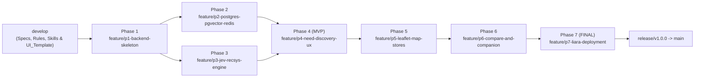

# ROADMAP — Torob Smart In-Person Shopping Assistant (دستیار هوشمند خرید حضوری ترب)

**Repository**: `git@github.com:Taha-Esmaeili/StarCoach-AgenticAI-Torob-Challenge.git`  
**Specification Suite**: [`specs/001-torob-shopping-assistant/`](file:///home/tahaes/Desktop/CodeCave/StarCoach/AgenticAiHackaton/Torob/specs/001-torob-shopping-assistant/)  
**RecSys & Jev Report**: [`JEV_MODEL_AND_RECSYS_REPORT.md`](file:///home/tahaes/Desktop/CodeCave/StarCoach/AgenticAiHackaton/Torob/JEV_MODEL_AND_RECSYS_REPORT.md)

---

## 1. Rubric-Driven Architecture & Scoring Map (300 Points Total)

| Judging Category | Points | Core Engineering & Product Deliverables | Target Phases |
| :--- | :---: | :--- | :---: |
| **Product Value** | **75** | End-to-end 4-step physical shopping journey: Need Discovery $\rightarrow$ Multi-Criteria Store Selection $\rightarrow$ Indoor Mall Micro-Navigation (`پاساژ/طبقه/واحد`) $\rightarrow$ Price Freshness Transparency & 1-Tap Closed-Store Fallback. | Phases 4, 5, 6 |
| **UX Beyond Chat** | **75** | Dark raspberry-pink RTL interface (`UI_Template/`), 1-Tap `FeatureClarificationCard`, live `Leaflet` dark Tehran map with price pins, dynamic `ComparisonMatrix`, and interactive 15-weight sliders. | Phases 4, 5, 6 |
| **Intelligence** | **50** | **Jev System One (`jev-1.14.0`) + 15-Parameter Adaptive RecSys** (`5 Base + 5 Persona + 5 Dynamic` slots), Two-Layer Weight Normalization, Confidence-Gated Fusion, Hybrid `pgvector` + `Jev` `Noul` Deduplication, Anti-Fatigue Clarification, and Pareto Top-3 Diversity. | Phase 3 |
| **Technical Quality** | **40** | FastAPI + **PostgreSQL + `pgvector` (+ Redis)** sub-50ms geo/trigram/vector/stock engine (`< 5 ms` Redis session & query cache), Dual-Mode `Jev` + OpenAI-compatible System-One fallback, and automated `pytest` assertions. | Phases 1, 2, 3 |
| **Dataset Mastery** | **20** | Strict separation of `offers.csv` (`331,506` stocked items) vs. `shops.category_names` fallback; literal `"null"` handling; `JSONB` GIN indexing for `weekly_hours`, `payment_options`, and `warranty`; 112 real Torob shops badge. | Phase 2 |
| **Liara Deployment** | **40** | Dockerized deployment on Liara (connected to managed PostgreSQL/`pgvector` & Redis) with health probe (`/api/v1/health`) + **Mandatory 5-Minute Demo Video**. | **Phase 7 (Final)** |

---

## 2. Branch & Phase Execution Roadmap (`/git-workflow` + `/teamwork`)

All feature branches originate from and merge back into `develop` via the mandatory **3-Gate User Approval Protocol** (Gate 1: Commit, Gate 2: Push, Gate 3: PR).

---

## 3. Milestone Checklist & Status

### Milestone 0: Architecture, Governance, Skills & SpecKit Suite (Current — `001-torob-shopping-assistant`)
- [x] Repository initialized with `main` and `develop` branches (`0ff3358`, `713dd64`)
- [x] Master [`AGENTS.md`](file:///home/tahaes/Desktop/CodeCave/StarCoach/AgenticAiHackaton/Torob/AGENTS.md) & 4 domain skills in [`.agents/skills/`](file:///home/tahaes/Desktop/CodeCave/StarCoach/AgenticAiHackaton/Torob/.agents/skills) (`beyond-chat-rtl-ux`, `torob-dataset-guard`, `typesafe-ai`, `speckit-teamwork`)
- [x] Base [`UI_Template/`](file:///home/tahaes/Desktop/CodeCave/StarCoach/AgenticAiHackaton/Torob/UI_Template) analyzed and committed cleanly (excluding bulky `.zip`/`.mp4` assets)
- [x] Mathematical & architectural deep-dive in [`JEV_MODEL_AND_RECSYS_REPORT.md`](file:///home/tahaes/Desktop/CodeCave/StarCoach/AgenticAiHackaton/Torob/JEV_MODEL_AND_RECSYS_REPORT.md)
- [x] Complete SpecKit suite in [`specs/001-torob-shopping-assistant/`](file:///home/tahaes/Desktop/CodeCave/StarCoach/AgenticAiHackaton/Torob/specs/001-torob-shopping-assistant/) (`constitution.md`, `spec.md`, `research.md`, `data-model.md`, `contracts/api.md`, `quickstart.md`, `plan.md`, `tasks.md`)

### Milestone 1: Foundation — FastAPI Contracts & PostgreSQL + `pgvector` (+ Redis) Indexing (Phases 1–2)
- [ ] **Phase 1 (`T001`–`T005`)**: `docker-compose.yml` (`pgvector:pg16` + `redis:7-alpine`), FastAPI skeleton, `.env` loader, Pydantic schemas (`backend/models/schemas.py`), and typed frontend API client (`UI_Template/src/api/client.ts`).
- [ ] **Phase 2 (`T006`–`T010`)**: PostgreSQL (`pgvector` + `pg_trgm` + `JSONB`) ingestion of `shops.csv` (`6,476`), `products.csv` (`225,903`), and `offers.csv` (`331,506`), indoor mall regex extractor (`پاساژ`/`طبقه`/`واحد`), Redis session/query caching, and sub-50ms geo+stock query engine.

### Milestone 2: Intelligence — Jev System One & 15-Parameter Adaptive RecSys (Phase 3)
- [ ] **Phase 3 (`T011`–`T016`)**: Dual-Mode `Jev` (`typesafe-sdk` + OpenAI System-One fallback), `5+5+5` slot manager, Two-Layer L1 normalization, Confidence-Gated Fusion, Hybrid `pgvector` (`<=>`) + `Jev` `Noul` deduplication, Hurdle $\Phi(i)$, Value-of-Travel coupling, Pareto Top-3 selector, and Anti-Fatigue Clarifier.

### Milestone 3: Beyond-Chat RTL UX Integration (Phases 4–6)
- [ ] **Phase 4 (`T017`–`T020`)**: Live conversational turns (`/api/v1/chat/turn`), `FeatureClarificationCard.tsx`, live 15-parameter sliders (`ProfilePrioritiesModal.tsx`), and 👍/👎 feedback loop.
- [ ] **Phase 5 (`T021`–`T023`)**: Enhanced `StoreCard.tsx` (`Why-This-Shop` pills, freshness & verified badges) + real dark-mode `Leaflet` map (`InteractiveMap.tsx`) with Toman price pins and Tehran neighborhood presets.
- [ ] **Phase 6 (`T024`–`T027`)**: Dynamic category spec `ComparisonMatrix.tsx` (`/api/v1/products/compare`) + `ShoppingCompanionModal.tsx` with indoor mall micro-guide and 1-tap closed-store rescue (`/api/v1/stores/{offer_id}/fallback`).

### Milestone 4: Final Phase — Liara Production Deployment & Demo Video (Phase 7)
- [ ] **Phase 7 (`T028`–`T030`)**: Multi-stage `Dockerfile`, `liara.json`, Liara cloud deployment verification, and 5-minute Hackathon Demo Video (`DEMO_SCRIPT.md`).
