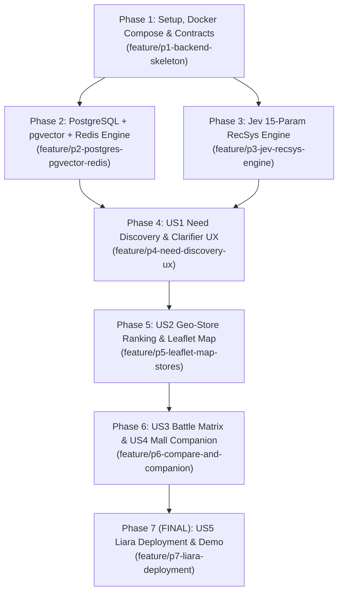

# Tasks: Torob Smart In-Person Shopping Assistant (`001-torob-shopping-assistant`)

**Input**: Design documents from [`specs/001-torob-shopping-assistant/`](file:///home/tahaes/Desktop/CodeCave/StarCoach/AgenticAiHackaton/Torob/specs/001-torob-shopping-assistant/) (`spec.md`, `plan.md`, `data-model.md`, `contracts/api.md`, `research.md`) and [`JEV_MODEL_AND_RECSYS_REPORT.md`](file:///home/tahaes/Desktop/CodeCave/StarCoach/AgenticAiHackaton/Torob/JEV_MODEL_AND_RECSYS_REPORT.md).  
**Git Strategy**: Each phase maps to a single-purpose `/git-workflow` branch created from `develop` (`feature/p1-*` .. `feature/p7-*`), with mandatory 3-Gate user approval before commit, push, and PR. **Liara deployment is strictly isolated to the final phase (Phase 7).**

---

## Phase 1: Setup & API Contracts (`feature/p1-backend-skeleton`)

**Purpose**: Initialize the Python FastAPI backend workspace, local `docker-compose.yml` for **PostgreSQL (`pgvector:pg16`) + Redis (`redis:7-alpine`)**, and shared typed contracts alongside `UI_Template/`.

- [X] T001 Create `docker-compose.yml` (`pgvector/pgvector:pg16` + `redis:7-alpine`), Python project dependencies (`fastapi`, `uvicorn`, `asyncpg`, `psycopg[binary]`, `pgvector`, `redis`, `pydantic`, `openai`, `typesafe-sdk`, `numpy`, `pytest`, `pytest-asyncio`) in `pyproject.toml`, and `.env.example`
- [X] T002 [P] Implement environment and settings loader (`DATABASE_URL`, `REDIS_URL`, `LLM_BASE_URL`, `LLM_API_KEY`, `LLM_MODEL`, `EMBEDDING_MODEL`, `TYPESAFE_API_KEY`, `TOROB_DATASET_DIR`) in `backend/config.py`
- [X] T003 [P] Implement Pydantic request/response schemas matching `contracts/api.md` in `backend/models/schemas.py`
- [X] T004 Create FastAPI application entrypoint with `asyncpg` + `redis` lifespan pools, CORS, RTL UTF-8 JSON defaults, and `/api/v1/health` probe in `backend/main.py`
- [X] T005 [P] Create typed frontend API client and Vite `/api` proxy configuration in `UI_Template/src/api/client.ts` and `UI_Template/vite.config.ts`

---

## Phase 2: Foundational — PostgreSQL + `pgvector` (+ Redis) Dataset Ingestion & Geo-Stock Engine (`feature/p2-postgres-pgvector-redis`)

**Purpose**: Index the 273 MB raw CSV dataset (`6,476` shops, `225,903` products, `331,506` offers) into **PostgreSQL (`pgvector` + `pg_trgm` + `JSONB`)** and wire **Redis** session/query caching with all [`torob-dataset-guard`](file:///home/tahaes/Desktop/CodeCave/StarCoach/AgenticAiHackaton/Torob/.agents/skills/torob-dataset-guard/SKILL.md) rules enforced.

**⚠️ CRITICAL**: Must complete before User Story phases so all endpoints query real indexed Torob data in `< 50 ms` (`< 5 ms` on Redis hit).

- [X] T006 Implement Persian text normalizer (`ی`/`ک` unification, ZWNJ cleanup, Persian/Arabic digit conversion) and indoor mall regex parser (`پاساژ`/`مجتمع`/`طبقه`/`واحد`/`پلاک`) in `backend/db/normalizer.py`
- [X] T007 Implement PostgreSQL schema DDL (`CREATE EXTENSION vector`, `CREATE EXTENSION pg_trgm`, `shops`, `products`, `offers`, `user_profiles`, `user_dynamic_slots`, `shopping_sessions`) and fast `COPY` ingestion pipeline for `shops.csv`, `products.csv`, and `offers.csv` (handling literal `"null"` strings, parsing `JSONB` columns, and flagging the 112 real Torob shops) in `backend/db/postgres.py` and `backend/db/ingest.py`
- [X] T008 Implement sub-second PostgreSQL query layer (`pg_trgm` + `pgvector` cosine `<=>` hybrid search, Haversine distance in Tehran, real-time shift open/closed evaluation, strict `offers.csv` stock join vs. labeled `shops.category_names` fallback) in `backend/db/queries.py`
- [X] T009 [P] Implement Redis + PostgreSQL write-through persistence for `user_profiles` (unconstrained $[0,1]^{15}$ weights), `user_dynamic_slots` (`pgvector` `vector(1536)`), `shopping_sessions` (`torob:session:{id}`), and query cache (`torob:qcache:{hash}`) in `backend/db/redis_cache.py` and `backend/db/profiles.py`
- [X] T010 Write assert-based dataset integrity, `pgvector` index check, Redis round-trip, and `< 50 ms` query benchmark self-check in `backend/tests/test_ingest_guard.py`

**Checkpoint**: `uv run pytest backend/tests/test_ingest_guard.py` passes with exact row counts (`6,476` / `225,903` / `331,506`) and sub-50ms retrieval.

---

## Phase 3: Foundational — Jev System One & 15-Parameter Adaptive RecSys (`feature/p3-jev-recsys-engine`)

**Purpose**: Build the mathematical core specified in [`JEV_MODEL_AND_RECSYS_REPORT.md`](file:///home/tahaes/Desktop/CodeCave/StarCoach/AgenticAiHackaton/Torob/JEV_MODEL_AND_RECSYS_REPORT.md).

- [X] T011 Implement Dual-Mode System One engine (`typesafe-sdk` `Jev` client using `Choice`, `Score`, `Noul`, `Box` with automatic OpenAI-compatible structured logprob/JSON fallback) in `backend/recsys/jev_engine.py`
- [X] T012 [P] Implement 15-Slot Weight Manager (`5 Base + 5 Persona + 5 Dynamic` slots), Two-Layer Normalization (unconstrained $[0,1]^{15}$ PostgreSQL/Redis storage + query-time L1 simplex normalization $\sum_{k=1}^{15} \hat{w}_k = 1$), and Confidence-Gated Fusion ($\alpha_k(q) = \operatorname{clip}(\gamma \cdot c_k(q), 0.15, 0.95)$) in `backend/recsys/weights.py`
- [X] T013 [P] Implement Hybrid Feature Deduplicator (Stage-1 `pgvector` cosine similarity `1 - (embedding <=> $1) > 0.80` + Stage-2 `Jev` `Noul` equivalence check in $[0.65, 0.80]$ + decayed utility LRU eviction for Slots 11–15) in `backend/recsys/deduplicator.py`
- [X] T014 Implement Utility Scorer with Hard-Constraint Dealbreaker Hurdle ($\Phi(i) \in \{1.0, 0.15\}$), Net Value-of-Travel coupling, Explainable `why_this_shop_fa` attribution, and Pareto-Front Top-3 selector (`best_overall`, `closest_open`, `lowest_price`) in `backend/recsys/scorer.py`
- [X] T015 [P] Implement Anti-Fatigue Clarification Policy backed by Redis session state (`clarification_count` gate: max 1 initial prompt when $\text{mean}(\text{EffConf}_k) < 0.45$, and at most 1 re-trigger upon 👎 or `user_dissatisfied.noul >= 0.70`) in `backend/recsys/clarifier.py`
- [X] T016 Write unit tests verifying L1 simplex normalization, zero DB weight dilution, hurdle penalties, and anti-fatigue state transitions in `backend/tests/test_recsys_math.py`

**Checkpoint**: `uv run pytest backend/tests/test_recsys_math.py` passes all mathematical invariants.

---

## Phase 4: User Story 1 — Conversational Need Discovery, Anti-Fatigue Clarification & Priority Sliders (Priority: P1) 🎯 MVP (`feature/p4-need-discovery-ux`)

**Goal**: Enable users to describe their shopping need in natural Persian, receive 1-tap clarification when ambiguous without chat fatigue, and interactively tune their 15-parameter profile weights.

**Independent Test**: Submit an ambiguous prompt (`"یه هندزفری خوب میخوام"`) and a specific prompt (`"سریع‌ترین شارژر آیفون سمت ونک"`), verify `FeatureClarificationCard.tsx` triggers at most once initially, and verify clicking a pill or 👍/👎 dynamically updates weights in Redis/PostgreSQL and re-ranks stores.

- [ ] T017 [US1] Implement `POST /api/v1/chat/turn` and `POST /api/v1/feedback` endpoints orchestrating `jev_engine`, `queries`, `redis_cache`, `scorer`, and `clarifier` in `backend/main.py`
- [ ] T018 [P] [US1] Wire `FeatureClarificationCard.tsx` component (2–3 selectable Persian priority pills + round badge) to live `clarification_card` payloads in `UI_Template/src/components/FeatureClarificationCard.tsx`
- [ ] T019 [P] [US1] Bind `ProfilePrioritiesModal.tsx` and the right-hand filter sidebar to live `recsys_state.active_weights` and `hard_constraints` in `UI_Template/src/components/ProfilePrioritiesModal.tsx` and `UI_Template/src/App.tsx`
- [ ] T020 [US1] Connect `App.tsx` chat turn handler, `SearchingPapersAnimation.tsx` loading states, and `ThumbsUp`/`ThumbsDown` feedback buttons to live backend endpoints in `UI_Template/src/App.tsx`

---

## Phase 5: User Story 2 — Multi-Criteria Geo-Store Ranking & Dark RTL Leaflet Map (Priority: P1) (`feature/p5-leaflet-map-stores`)

**Goal**: Present top-ranked physical stores in Tehran on rich interactive cards and a real dark-mode Leaflet map with price pins, travel time, and explainable ranking badges.

**Independent Test**: Search any stocked product, inspect the Pareto Top-3 badges (`بهترین انتخاب کلی`, `نزدیک‌ترین مغازه باز`, `کمترین قیمت`), verify `Why-This-Shop` pills, and pan/zoom the interactive Tehran map with custom price pins.

- [ ] T021 [P] [US2] Upgrade `StoreCard.tsx` to display `pareto_badge_fa`, `why_this_shop_fa` attribution chips, `freshness_badge_fa`, installment provider pills (`ترب‌پی`, `اسنپ‌پی`), `تایید شده ترب` badge (for the 112 real shops), and the amber category-fallback notice in `UI_Template/src/components/StoreCard.tsx`
- [ ] T022 [P] [US2] Install `leaflet` and `@types/leaflet` in `UI_Template/package.json` and upgrade `InteractiveMap.tsx` from mock SVG to a live dark-matter RTL Leaflet map of Tehran with custom Toman price pins, user GPS marker, and animated route polyline in `UI_Template/src/components/InteractiveMap.tsx`
- [ ] T023 [US2] Synchronize store selection between `StoreCard.tsx`, `InteractiveMap.tsx`, and the user location selector (browser Geolocation API + Tehran neighborhood presets like `ولیعصر`, `جمهوری`, `ونک`, `صادقیه`) in `UI_Template/src/App.tsx`

---

## Phase 6: User Stories 3 & 4 — Dynamic Model Battle Matrix, Indoor Mall Micro-Guide & 1-Tap Fallback (Priority: P2) (`feature/p6-compare-and-companion`)

**Goal**: Deliver dynamic category-aware product comparison (`US3`) and the on-site in-person shopping companion with `پاساژ/طبقه/واحد` micro-navigation, price freshness transparency, and 1-tap closed-store rescue (`US4`).

**Independent Test**: Compare 2 models via `ComparisonMatrix.tsx` to see real `products.specs_json` + live Tehran store counts; open `ShoppingCompanionModal.tsx` on a mall store to see extracted `پاساژ`/`طبقه`/`واحد` badges, and click **"مغازه بسته بود / موجود نداشت — جایگزین فوری"** to switch to the nearest open alternative in `< 300 ms`.

- [ ] T024 [P] [US3] Implement `GET /api/v1/products/compare` endpoint extracting category-specific `specs_json` from PostgreSQL `products` and aggregating live Tehran open-store counts and minimum prices from `offers` in `backend/main.py` and `backend/db/queries.py`
- [ ] T025 [P] [US3] Upgrade `ComparisonMatrix.tsx` to render dynamic category spec rows, live in-person minimum price, open store counts, and 1-tap "مشاهده فروشندگان حضوری این مدل" action in `UI_Template/src/components/ComparisonMatrix.tsx`
- [ ] T026 [P] [US4] Implement `GET /api/v1/stores/{offer_id}/fallback` endpoint (prioritizing open stores in the same `mall_name` first, then nearest street stores with `w_distance` and `w_open_now` boosted) in `backend/main.py` and `backend/db/queries.py`
- [ ] T027 [US4] Upgrade `ShoppingCompanionModal.tsx` and `StoreContactModal.tsx` with extracted `mall_micro_guide` (`پاساژ`/`طبقه`/`واحد`), `last_price_changed_at` freshness alert, callable `tel:` link, Instagram/Website links, and the 1-tap **"مغازه بسته بود / موجود نداشت — جایگزین فوری"** rescue flow in `UI_Template/src/components/ShoppingCompanionModal.tsx` and `UI_Template/src/components/StoreContactModal.tsx`

---

## Phase 7: Final Phase — Liara Deployment & 5-Minute Demo Video (Priority: P3 — Strictly Last) (`feature/p7-liara-deployment`)

**Goal**: Package the verified full-stack application for deployment on Liara (connected to Liara PostgreSQL/`pgvector` + Redis, 40 pts) and produce the mandatory 5-minute demo walkthrough script.

**⚠️ NOTE**: Execute this phase **only after Phases 1–6 are complete and locally verified**.

- [ ] T028 [P] [US5] Configure FastAPI to serve the compiled `UI_Template/dist` static bundle and SPA fallback route in `backend/main.py`
- [ ] T029 [P] [US5] Create multi-stage `Dockerfile` (building `UI_Template/dist` with Node 22 + running FastAPI with Python 3.11 and automatic PostgreSQL `pgvector` + Redis health/migration check) and `liara.json` in `Dockerfile` and `liara.json`
- [ ] T030 [US5] Author the 5-minute Hackathon Demo Video script & rubric-mapped judge walkthrough in `DEMO_SCRIPT.md`

---

## Dependencies & Execution Order

### Parallel Opportunities (`/teamwork` Subagent Ready)
- **Phase 2 (`backend/db/*` — PostgreSQL + `pgvector` + Redis)** and **Phase 3 (`backend/recsys/*` — Jev 15-Param Engine)** can be developed in parallel once Phase 1 schemas (`backend/models/schemas.py`) are merged into `develop`.
- Within **Phase 4–6**, backend route handlers (`T017`, `T024`, `T026`) and frontend React components (`T018`, `T021`, `T022`, `T025`, `T027`) touch disjoint directories (`backend/` vs. `UI_Template/src/components/`) and can run in parallel.
