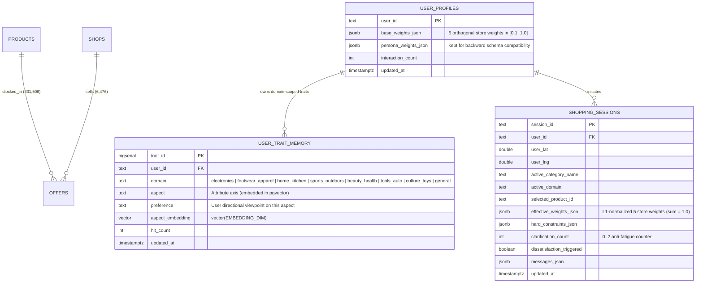

# Phase 1 Data Model: Two-Stage Jev Recommender System & Domain-Scoped Trait Memory

**Feature**: `002-jev-domain-recsys` | **Date**: 2026-11-12 | **Spec**: [spec.md](file:///home/tahaes/Desktop/CodeCave/StarCoach/AgenticAiHackaton/Torob/specs/002-jev-domain-recsys/spec.md)

---

## 1. Entity Relationship Diagram



---

## 2. PostgreSQL + `pgvector` Schema DDL (`backend/db/postgres.py`)

### A. New Production Table: `user_trait_memory`
Replaces the fixed 5-slot cross-category `user_dynamic_slots` bottleneck while keeping `user_dynamic_slots` in DDL for backward-compatible test migrations:

```sql
CREATE TABLE IF NOT EXISTS user_trait_memory (
    trait_id BIGSERIAL PRIMARY KEY,
    user_id TEXT NOT NULL REFERENCES user_profiles(user_id) ON DELETE CASCADE,
    domain TEXT NOT NULL,
    aspect TEXT NOT NULL,
    preference TEXT NOT NULL,
    aspect_embedding vector(1536),
    hit_count INTEGER NOT NULL DEFAULT 1,
    updated_at TIMESTAMPTZ NOT NULL DEFAULT NOW()
);

CREATE INDEX IF NOT EXISTS idx_user_trait_memory_user_domain
    ON user_trait_memory (user_id, domain);
```

### B. 5 Orthogonal Store Criteria in `user_profiles.base_weights_json`
Stored unconstrained in $[0.10, 1.00]^5$ (default `0.30` each via `.env`):

| Key | Slot # | Persian Label (`label_fa`) | Store Feature Formula $f_{i,k} \in [0, 1]$ |
| :--- | :---: | :--- | :--- |
| `w_price` | 1 | کمترین قیمت و صرفه اقتصادی | $\exp\!\left(-\frac{P_i - P_{\min}}{\tau_{\text{price}} \cdot P_{\min}}\right)$ with $\tau_{\text{price}} = 0.15$ |
| `w_distance` | 2 | نزدیکی و سرعت دسترسی حضوری | $\exp\!\left(-\frac{d_i}{\tau_{\text{dist}}}\right)$ with $\tau_{\text{dist}} = 8.0\text{ km}$ |
| `w_open_now` | 3 | باز بودن فروشگاه در این لحظه | `1.0` (open) / `0.4` (unknown hours) / `0.0` (closed) |
| `w_trust_freshness` | 4 | تازگی قیمت، گارانتی و اعتبار فروشگاه | $0.65 \exp(-\Delta t_{\text{days}}/14) + 0.20\,\mathbb{I}(\text{real\_shop}) + 0.15\,\mathbb{I}(\text{warranty})$ |
| `w_installment` | 5 | پرداخت اقساطی حضوری (ترب‌پی/اسنپ‌پی) | `1.0` (verified in-person credit) / `0.0` (none) |

*(Note: For 100% backward compatibility with existing unit tests and UI sliders that reference legacy keys like `w_freshness`, `w_score`, `w_warranty`, or `w_verified_shop`, `weights.py` aliases/maps those keys cleanly onto `w_trust_freshness` or preserves them as optional aliases.)*

---

## 3. Domain-Scoped Trait Memory Lifecycle & Validation Rules

1. **Universal Commerce Domains (`VALID_DOMAINS`)**:
   - `electronics` (موبایل، لپ‌تاپ، هدفون، قطعات دیجیتال و لوازم جانبی)
   - `footwear_apparel` (کفش، کتانی، پوشاک، کیف و اکسسوری)
   - `home_kitchen` (لوازم خانگی، آشپزخانه، دکوراسیون و مبلمان)
   - `sports_outdoors` (تجهیزات ورزشی، اسکوتر، دوچرخه و کمپینگ)
   - `beauty_health` (آرایشی، بهداشتی، عطر و تجهیزات پزشکی خانگی)
   - `tools_auto` (ابزارآلات صنعتی، تجهیزات خودرو و موتورسیکلت)
   - `culture_toys` (کتاب، نوشت‌افزار، اسباب‌بازی و سرگرمی)
   - `general` (سایر دسته‌های عمومی)
2. **Durability Gate (`is_durable`)**:
   - Ephemeral one-off constraints (e.g., *"کادو برای دوستم"*, *"تا ساعت ۶ غروب"*) are filtered out before entering `user_trait_memory`.
3. **Aspect-Only Embedding & Polarity-Safe Upsert**:
   - Only `aspect` (normalized Persian text of the attribute dimension) is passed to `embed_text_async`.
   - When a new `(domain, aspect_new, preference_new)` arrives in the background worker:
     1. Query `user_trait_memory` for the top-3 rows with the same `(user_id, domain)` ordered by `aspect_embedding <=> $1::vector ASC`.
     2. If the best cosine similarity is `< 0.60`, insert a new row.
     3. If the best cosine similarity is `>= 0.60`, evaluate `check_same_aspect_noul(aspect_new, aspect_stored)`:
        - If `noul >= 0.70` (same attribute axis, even if `preference_new` is the opposite polarity of `preference_stored`): **UPDATE** `preference = preference_new`, `hit_count = hit_count + 1`, `updated_at = NOW()`.
        - Otherwise: **INSERT** a new row.
