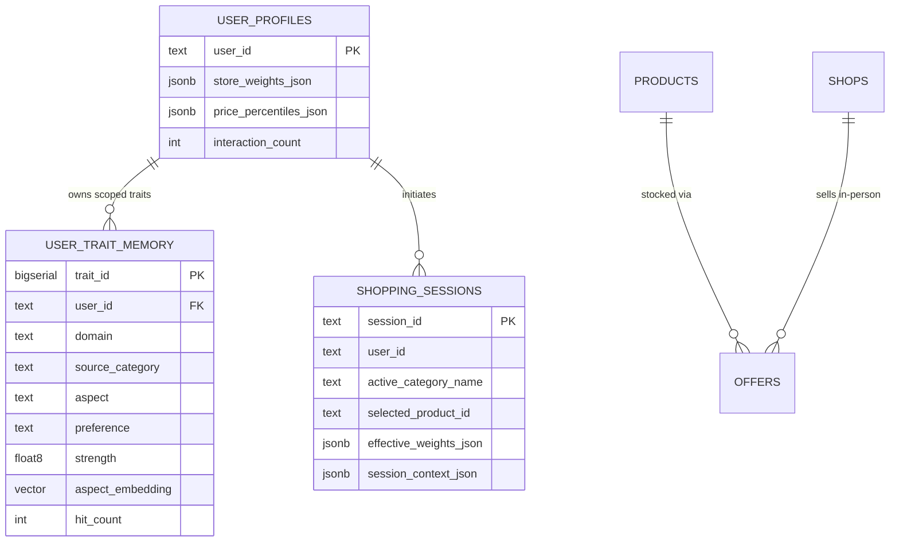

# Phase 1 Data Model (`003-clean-adaptive-recsys`)

**Feature**: Clean Two-Layer Adaptive Recommender System  
**Storage Engine**: PostgreSQL 16 (`JSONB` + `pg_trgm` + `pgvector`) + Redis 7 Read/Write-Through Cache

---

## 1. Entity Overview & Schema Changes

### 1.1 Purged Schema Artifacts (Removed Completely)
1. **`user_dynamic_slots` table**: Dropped (`DROP TABLE IF EXISTS user_dynamic_slots CASCADE;`). Replaced completely by `user_trait_memory`.
2. **`products.embedding` column**: Dropped (`ALTER TABLE products DROP COLUMN IF EXISTS embedding;`). Never populated by `ingest.py` (`NULL` across all 225,903 rows).
3. **Legacy `user_profiles` split columns (`base_weights_json`, `persona_weights_json`)**: Consolidated into `store_weights_json` + `price_percentiles_json` (with automatic migration fallback from `base_weights_json` if present on upgrade).

---

## 2. Core PostgreSQL Tables (Target State)

### 2.1 Catalog Tables (`shops`, `products`, `offers` — Preserved from Dataset Guard)
- **`shops` (`6,476` rows, `112` verified `is_real_torob_shop = TRUE`)**: Unchanged (`shop_id`, `name`, `normalized_name`, `latitude`, `longitude`, `address`, `mall_name`, `floor_label`, `unit_label`, `mall_note`, `primary_phone`, `score`, `votes_count`, `has_in_person_installment`, `installment_providers`, `weekly_hours_json`, `category_names_json`, `website_url`, `instagram`, `is_real_torob_shop`).
  - *Runtime Fix*: `evaluate_weekly_hours(weekly_hours_json)` evaluates against `ZoneInfo("Asia/Tehran")`.
- **`products` (`225,903` rows)**: `product_id`, `persian_title`, `normalized_name` (GIN `pg_trgm`), `model_name`, `category_name`, `brand_name`, `image_url`, `image_urls_json`, `specs_json`, `min_price_toman`, `max_price_toman`, `offer_count` (`embedding` column removed).
- **`offers` (`331,506` rows)**: `offer_id`, `product_id`, `shop_id`, `price_toman`, `seller_title`, `description`, `warranty_raw`, `has_official_warranty`, `warranty_provider`, `warranty_months`, `last_price_changed_at`.
  - *Retrieval Upgrade*: `seller_title` and `description` are now fetched in `fetch_candidate_offers` and probed in `search_products` for offer-level traits (`استوک`, `اوپن‌باکس`, `پارت‌نامبر`, `ریجسترشده`).

---

### 2.2 `user_profiles` (`Store Behavioral Profile` + `Domain Price Prior`)

Stores long-term, revealed-preference behavioral weights for Layer 2 and dimensionless price percentiles per macro-domain for Layer 1.

```sql
CREATE TABLE IF NOT EXISTS user_profiles (
    user_id TEXT PRIMARY KEY,
    store_weights_json JSONB NOT NULL,
    price_percentiles_json JSONB NOT NULL DEFAULT '{}'::jsonb,
    interaction_count INTEGER NOT NULL DEFAULT 0,
    updated_at TIMESTAMPTZ NOT NULL DEFAULT NOW()
);
```

- **`store_weights_json` structure** (5 unconstrained floats in `[0.10, 1.00]`):
  ```json
  {
    "w_price": 0.30,
    "w_distance": 0.30,
    "w_open_now": 0.30,
    "w_trust_freshness": 0.30,
    "w_installment": 0.30
  }
  ```
- **`price_percentiles_json` structure** (`Open-Category Price Prior` — zero hardcoded category enums):
  ```json
  {
    "لپ‌تاپ و نوت‌بوک": {"percentile": 0.74, "count": 3},
    "کفش روزمره": {"percentile": 0.48, "count": 2},
    "__global__": {"percentile": 0.63, "count": 5}
  }
  ```
  *(Keyed dynamically by actual catalog `category_name`; Turn-1 `Jev` `price_prior_transfer_{idx}` selects applicable historical category percentiles for sibling categories without any hardcoded domain list).*
- **Validation & State Transition Rules**:
  - Never modified during chat text turns, `clarification_choice`, `thumbs_down`, or sessions flagged `is_ephemeral_or_gift = true`.
  - `store_weights_json` updates **only** on positive store/offer selection (`thumbs_up` with `target_offer_id`) via contrastive delta against `shown_store_features` or direct `weight_override` slider edits.
  - `price_percentiles_json[category_name]` (and `"__global__"`) updates **only** on positive product/offer selection when `not is_ephemeral_or_gift`.

---

### 2.3 `user_trait_memory` (`Category-Agnostic Scoped User Trait` with Top-2 Inertia)

Stores open-vocabulary product preferences per `user_id` with dynamic open-vocabulary `source_category` (grounded from `products.category_name` or model-inferred category—**zero hardcoded `VALID_DOMAINS` enum**) and `strength` (enabling non-destructive Top-2 retention per aspect).

```sql
CREATE TABLE IF NOT EXISTS user_trait_memory (
    trait_id BIGSERIAL PRIMARY KEY,
    user_id TEXT NOT NULL REFERENCES user_profiles(user_id) ON DELETE CASCADE,
    source_category TEXT NOT NULL DEFAULT '',
    aspect TEXT NOT NULL,
    preference TEXT NOT NULL,
    strength DOUBLE PRECISION NOT NULL DEFAULT 0.50,
    aspect_embedding vector(1536),
    hit_count INTEGER NOT NULL DEFAULT 1,
    updated_at TIMESTAMPTZ NOT NULL DEFAULT NOW()
);

CREATE INDEX IF NOT EXISTS idx_user_trait_memory_user_strength
    ON user_trait_memory (user_id, strength DESC, updated_at DESC);
```

- **Zero Hardcoded Domain Enum**: Legacy `domain` column (`electronics`, `footwear_apparel`, ...) is dropped (`ALTER TABLE user_trait_memory DROP COLUMN IF EXISTS domain;`) so arbitrary categories work natively.
- **Upsert & Retention Invariants**:
  1. **Outlier / Gift Guard**: Skipped completely if session `is_ephemeral_or_gift == true`.
  2. **Aspect Deduplication**: Offline/background `aspect` embedding cosine candidate check (`>= RECSYS_TRAIT_COSINE_CANDIDATE_THRESHOLD`) + parallel Decision Model `Noul` same-aspect & compatible-scope check (`>= RECSYS_TRAIT_JEV_SAME_ASPECT_NOUL`).
  3. **Same Preference Match**: `hit_count += 1`, `strength = round(1.0 - (1.0 - strength) * (1.0 - alpha), 4)` (`alpha = 0.15` on stabilized session turn; `alpha = 0.35` on confirmed selection).
  4. **Competing Preference on Same Aspect**: Existing rival rows on the matched `(source_category, aspect)` decay by `strength *= RECSYS_TRAIT_RIVAL_DECAY` (`0.92`); new row inserted with `strength = alpha`; only the **Top `RECSYS_MAX_PREFERENCES_PER_ASPECT` (`2`)** rows per matched aspect are kept.
  5. **Online Retrieval Cap**: At most `RECSYS_MAX_STORED_TRAITS_PER_USER` (`15`) highest-strength rows are passed into Turn-1 `Jev` selective transfer evaluation.

---

### 2.4 `shopping_sessions` (`Durable Shopping Session`)

Stores full multi-turn conversational & recommender working state in Redis (`torob:session:{session_id}`) **and** PostgreSQL so cache eviction causes zero context loss.

```sql
CREATE TABLE IF NOT EXISTS shopping_sessions (
    session_id TEXT PRIMARY KEY,
    user_id TEXT NOT NULL,
    user_lat DOUBLE PRECISION NOT NULL,
    user_lng DOUBLE PRECISION NOT NULL,
    active_category_name TEXT,
    selected_product_id TEXT,
    effective_weights_json JSONB NOT NULL DEFAULT '{}'::jsonb,
    hard_constraints_json JSONB NOT NULL DEFAULT '{}'::jsonb,
    clarification_count INTEGER NOT NULL DEFAULT 0,
    dissatisfaction_triggered BOOLEAN NOT NULL DEFAULT FALSE,
    messages_json JSONB NOT NULL DEFAULT '[]'::jsonb,
    session_context_json JSONB NOT NULL DEFAULT '{}'::jsonb,
    updated_at TIMESTAMPTZ NOT NULL DEFAULT NOW()
);
```

- **`session_context_json` fields**:
  - `active_domain: str` (`"general"` default — fixes `"general_retail"` bug)
  - `product_search_query: str`
  - `catalog_search_terms: list[str]` (dynamic concept-to-catalog expansions)
  - `category_keywords: list[str]`
  - `is_accessory_request: bool`
  - `is_ephemeral_or_gift: bool`
  - `custom_offer_criterion: str` (open-vocabulary Layer 2 requirement, empty string when absent)
  - `active_session_traits: list[dict[str, str]]` (latest stabilized turn traits)
  - `transferred_traits: list[dict[str, Any]]` (validated historical traits for current item)
  - `price_tier: str` (`budget | mid | premium | unspecified`)
  - `min_price_toman: int | None`
  - `max_price_toman: int | None`
  - `category_price_span: dict[str, int]` (`{"min": ..., "max": ...}` for percentile calculation)
  - `session_weights: dict[str, dict[str, float]]`
  - `shown_store_features: dict[str, dict[str, float]]` (keyed by `str(offer_id)` for contrastive store weight learning; plus `"__mean__"` fallback)

---

## 3. Entity Relationship Diagram


