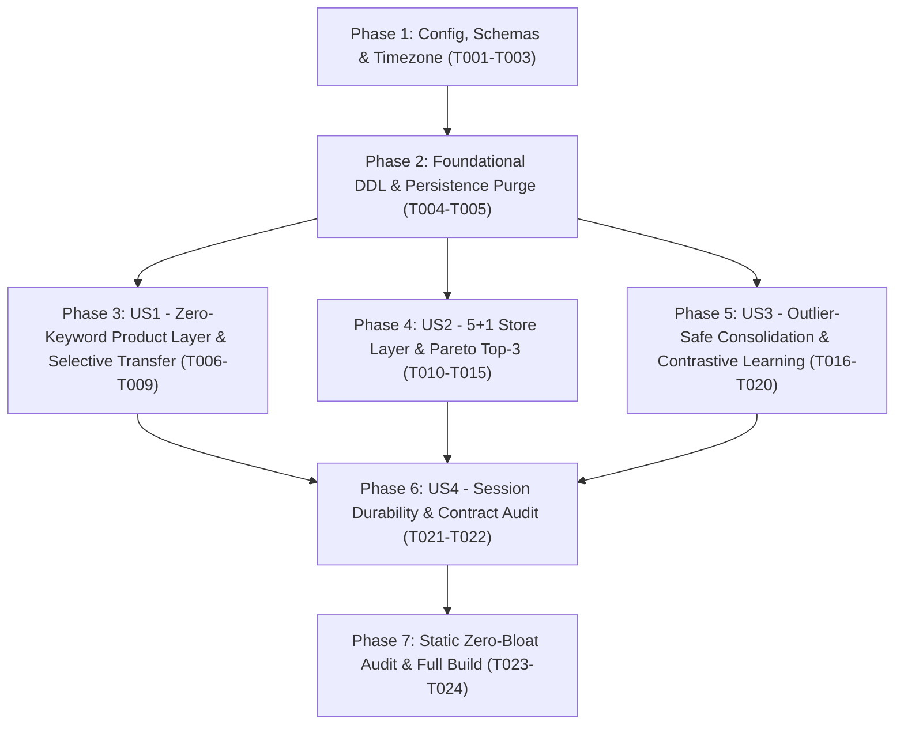

---

description: "Actionable, dependency-ordered task list for Clean Two-Layer Adaptive Recommender System (003-clean-adaptive-recsys)"
---

# Tasks: Clean Two-Layer Adaptive Recommender System (`003-clean-adaptive-recsys`)

**Input**: Design documents from `/specs/003-clean-adaptive-recsys/` (`plan.md`, `spec.md`, `cleanup-and-implementation-audit.md`, `research.md`, `data-model.md`, `contracts/recsys-api.md`, `quickstart.md`)

**Prerequisites**: `plan.md`, `spec.md`, `research.md`, `data-model.md`, `contracts/recsys-api.md`

**Core Architectural Invariant (Non-Negotiable Across All Tasks)**:
- **Zero Hardcoded Categories, Domains, Keywords, or Regex Rules**: Do NOT put any category names (e.g., `electronics`, `footwear_apparel`, `لپ‌تاپ`, `گوشی موبایل`, `کفش`), category-specific defaults (e.g., `"گارانتی ۱۸ ماهه"`), stopword sets, or regex matchers in Python/TypeScript logic. Every mechanism must operate dynamically and generally across **any random or unseen Torob category**.

**Organization**: Tasks are grouped by user story (`US1`..`US4`) so each story can be implemented and validated as a clean, atomic increment.

## Format: `[ID] [P?] [Story] Description`

- **[P]**: Can run in parallel (different files, no dependencies on incomplete tasks)
- **[Story]**: Maps directly to user stories in `specs/003-clean-adaptive-recsys/spec.md` (`[US1]`, `[US2]`, `[US3]`, `[US4]`)
- Exact repository-relative file paths are included in every task

---

## Phase 1: Setup & `.env` Configuration Hygiene

**Purpose**: Establish clean, 100% `.env`-driven configuration and backward-compatible API/DTO contracts before modifying database and recommender engines.

- [X] T001 Purge all 16 dead 15-slot settings/properties (`recsys_base_slots`, `recsys_persona_slots`, `recsys_dynamic_slots`, `recsys_default_base_weights_json`, `recsys_default_persona_weights_json`, `default_base_weights`, `default_persona_weights`, `recsys_fusion_*`, `recsys_ema_learning_rate`, `recsys_dynamic_slot_decay_lambda`, `recsys_dedup_*`, `recsys_travel_*`, `recsys_bayesian_prior_votes`) and add general two-layer `.env` hyperparameters (`recsys_total_slots=6`, `recsys_trait_transfer_noul_threshold=0.72`, `recsys_ephemeral_gift_noul_threshold=0.60`, `recsys_max_stored_traits_per_user=15`, `recsys_max_preferences_per_aspect=2`, `recsys_trait_soft_step=0.15`, `recsys_trait_confirmed_step=0.35`, `recsys_trait_rival_decay=0.92`, `recsys_custom_offer_top_k=15`, `recsys_price_prior_boost_weight=0.12`) in `backend/config.py` and `.env.example`
- [X] T002 [P] Update `FeedbackRequest` with optional `target_offer_id: str | int | None = None` and `target_product_id: str | int | None = None` (fixing Bug #1 `HTTP 500 AttributeError`) and bind `ActiveWeightSlot.slot` upper bound to `settings.recsys_total_slots` (`6`) in `backend/models/schemas.py`
- [X] T003 [P] Switch `evaluate_weekly_hours` from `datetime.now(timezone.utc)` to `ZoneInfo("Asia/Tehran")` (fixing Bug #10 3.5-hour timezone drift) in `backend/db/normalizer.py`

---

## Phase 2: Foundational Schema & Storage Purge (Blocking Prerequisites)

**Purpose**: Upgrade PostgreSQL DDL idempotently, drop legacy 15-slot tables/columns/hardcoded `domain` column, and unify profile & session persistence so all user stories build on the clean data model.

**⚠️ CRITICAL**: Complete Phase 2 before starting User Story phases (`US1`–`US4`).

- [X] T004 Update `get_schema_ddl` and `ensure_schema` with idempotent migrations (`DROP TABLE IF EXISTS user_dynamic_slots CASCADE`, `ALTER TABLE products DROP COLUMN IF EXISTS embedding`, `user_profiles` consolidated to `store_weights_json JSONB NOT NULL` + `price_percentiles_json JSONB NOT NULL DEFAULT '{}'::jsonb`, `user_trait_memory` updated with `DROP COLUMN IF EXISTS domain`, `source_category TEXT NOT NULL DEFAULT ''`, `strength DOUBLE PRECISION NOT NULL DEFAULT 0.50` and index `(user_id, strength DESC, updated_at DESC)`, plus `shopping_sessions.session_context_json JSONB NOT NULL DEFAULT '{}'::jsonb`) in `backend/db/postgres.py`
- [X] T005 Refactor profile, trait, and session persistence to remove `find_closest_dynamic_slot_pgvector` and all `user_dynamic_slots` queries, persist/load `store_weights_json` + open-category `price_percentiles_json`, load top `settings.recsys_max_stored_traits_per_user` (`15`) category-agnostic traits ordered by `(strength DESC, updated_at DESC)`, and persist full `session_context_json` in both Redis and PostgreSQL in `backend/db/profiles.py`

**Checkpoint**: Clean database DDL and persistence layer ready — zero `user_dynamic_slots`, zero `products.embedding`, and zero hardcoded `domain` columns remain.

---

## Phase 3: User Story 1 - Selective Cross-Category Trait Transfer & Zero-Keyword Product Layer (Priority: P1) 🎯 MVP

**Goal**: Enable any random/unseen product query (direct, conceptual/colloquial, or offer-condition like `استوک`) to expand dynamically into catalog search terms, transfer **only** physically/numerically valid past user traits (`source_category`, `aspect`, `preference`) in a single parallel Decision Model pass (`0` extra network RTT), and rank candidate products semantically without any hardcoded keywords, regexes, or hallucinated trait badges.

**Independent Test**: Seed mixed traits in any arbitrary category A (e.g., 10 traits on laptops or hiking gear), query a different category B (e.g., phones, headphones with indirect phrasing `"صدای اطراف نیاد"`, or `"لپ‌تاپ استوک"`), and verify: (1) incompatible traits are rejected (`0%` leak), (2) compatible traits soft-boost ranking and semantically match specs (`6000mAh` -> high battery), (3) `استوک` surfaces from `offers.seller_title`/`offers.description`, and (4) non-matching cards show `0%` false trait badges.

### Tests for User Story 1

- [X] T006 [P] [US1] Add unit/mocked tests verifying category-agnostic selective trait transfer (`noul >= settings.recsys_trait_transfer_noul_threshold`), zero-keyword concept expansion, semantic trait attribution (`0%` fallback badge hallucination), and open-category price percentile soft boost in `backend/tests/test_recsys_math.py`

### Implementation for User Story 1

- [X] T007 [P] [US1] Purge `_PARTICLES_FA`, `_ACCESSORY_CATEGORY_REGEX`, substring `rerank_products_with_domain_traits`, and unused `query_embedding` param; update `search_products` and `fetch_candidate_offers` to incorporate model-expanded `catalog_search_terms`, soft-boost matching on `products.normalized_name` / `products.specs_json`, and `EXISTS` / fetched `offers.seller_title` & `offers.description` in `backend/db/queries.py`
- [X] T008 [US1] Purge `VALID_DOMAINS`, `FIXED_SLOT_CATALOG`, `CandidateDynamicSpec`, legacy alias copies, and `check_feature_equivalence_noul`; implement category-agnostic Turn-1 parallel `Jev` evaluation (`trait_transfer_{idx}`, `price_prior_transfer_{c}`, `is_ephemeral_or_gift`, `needs_clarification`), dynamic `catalog_search_terms` extraction, and 100% Decision-Model product trait satisfaction scoring (removing forced `matched_prefs.append(traits[0])`) in `backend/recsys/jev_engine.py`
- [X] T009 [US1] Remove online `embed_text_async(req.message)`, `rerank_products_with_domain_traits` calls, forced `matched_prefs[0]` fallback badge (`#L182-L183`), and hardcoded `"گوشی موبایل"` fallback (`#L602`), wiring selective trait transfer, `catalog_search_terms`, and open-category `Domain Price Prior` ($\pi_{u,c} \in [0, 1]$ when budget is unspecified) into `post_chat_turn` in `backend/main.py`

**Checkpoint**: User Story 1 (Layer 1 Product Intelligence) works end-to-end across any arbitrary category with zero regexes/keyword lists and `-300 ms` lower turn latency.

---

## Phase 4: User Story 2 - Independent Store Ranking with 5 Base Metrics + Open-Vocabulary Offer Slot & True Pareto Top-3 (Priority: P1)

**Goal**: Rank stocked Tehran physical stores using 5 orthogonal numerical metrics (`w_price`, `w_distance`, `w_open_now`, `w_trust_freshness`, `w_installment`) completely un-diluted by Layer 1 trait count, dynamically activate a 6th open-vocabulary slot (`w_offer_custom`) across up to `15` candidate offers whenever the user expresses unstructured location/offer conditions (e.g., target mall/neighborhood `"سمت چارسو"`, part-number, color, test guarantee, stock grade), and physically place the 3 Pareto roles at indices `[0, 1, 2]`.

**Independent Test**: Verify (1) 5 product traits + 1 explicit store criterion keeps store criterion weight `>= 0.80`, (2) unmentioned store criteria read directly from `user_profiles.store_weights_json` using `settings.recsys_mention_score_threshold` (`0.35`, no `0.18` cap), (3) `custom_offer_criterion` scores `(shop_name, address, mall_name, seller_title, description, warranty_raw)` across top `15` offers, and (4) `stores[0..2]` hold `best_overall`, `closest_open`, and `lowest_price`.

### Tests for User Story 2

- [X] T010 [P] [US2] Add unit tests verifying `.env`-exact `recsys_mention_score_threshold` (`>= 80%` sparse override share), conditional 6th `w_offer_custom` fusion & scoring, physical `[0, 1, 2]` Pareto reordering, and category-neutral clarification generation in `backend/tests/test_recsys_math.py`

### Implementation for User Story 2

- [X] T011 [P] [US2] Purge `compute_fusion_alpha` and legacy slot alias resolution, remove hardcoded `min(..., 0.18)` override in `fuse_and_normalize_weights`, and support conditional `slot 6` (`w_offer_custom`) L1 normalization when `custom_offer_criterion` is non-empty in `backend/recsys/weights.py`
- [X] T012 [P] [US2] Implement `score_custom_offer_criterion_with_decision_model` batching at most `settings.recsys_custom_offer_top_k` (`15`) candidate offers over `(shop_name, address, mall_name, seller_title, description, warranty_raw)` when `custom_offer_criterion` is non-empty (`0` calls when empty) in `backend/recsys/jev_engine.py`
- [X] T013 [P] [US2] Purge unused `dynamic_slots` parameter and legacy feature output keys (`w_freshness`, `w_score`, `w_warranty`, `w_verified_shop`), integrate `f_offer_custom` into utility scoring, and physically reorder distinct qualifying offers so `best_overall`, `closest_open`, and `lowest_price` occupy indices `0`, `1`, and `2` in `backend/recsys/scorer.py`
- [X] T014 [P] [US2] Purge dead keyword-matching `map_clarification_answers_to_deltas`, replace legacy `w_warranty`/`w_verified_shop` keys with `w_trust_freshness`, and make `build_clarification_card` accept dynamic model-generated questions for arbitrary categories with a strictly category-neutral fallback (removing electronics-biased `"گارانتی ۱۸ ماهه"`) in `backend/recsys/clarifier.py`
- [X] T015 [US2] Wire conditional `w_offer_custom` scoring into `post_chat_turn` / `post_feedback` and fix `get_store_fallback` (`#L918-L923`) to pass `l1_normalize_weights(settings.default_store_weights)` in `backend/main.py`

**Checkpoint**: User Story 2 (Layer 2 Store Intelligence & Pareto Top-3) is independently functional across both numerical and arbitrary open-vocabulary store/offer requests.

---

## Phase 5: User Story 3 - Outlier-Safe Post-Session Consolidation & Revealed-Preference Learning (Priority: P1)

**Goal**: Protect long-term user profiles from gift/temporary outlier queries and `👎` clicks, retain up to Top-2 competing preferences per aspect with repetition inertia (`strength`), and learn `store_weights_json` strictly from revealed positive store/offer selections (`Contrastive Update`) or explicit slider overrides.

**Independent Test**: Simulate an established user (`hit_count >= 5`), run (1) a gift/temporary query (`is_ephemeral_or_gift >= 0.60`), (2) a `thumbs_down` click, (3) a new competing brand preference on an existing aspect, and (4) a `thumbs_up` / store selection with `target_offer_id`, confirming `0%` profile corruption on (1)–(2), Top-2 retention on (3), and contrastive weight delta in `[0.10, 1.00]` on (4).

### Tests for User Story 3

- [X] T016 [P] [US3] Add unit and API tests for `is_ephemeral_or_gift` shield, Top-2 per-aspect `strength` inertia (`alpha=0.15` soft vs. `0.35` confirmed, `0.92` rival decay), `thumbs_down` zero-mutation safety, and `thumbs_up` (`target_offer_id`) contrastive store & price-percentile learning in `backend/tests/test_recsys_math.py` and `backend/tests/test_api_endpoints.py`

### Implementation for User Story 3

- [X] T017 [P] [US3] Purge 106-line dead `upsert_dynamic_spec_slots` function and rewrite `sync_user_traits` to enforce `is_ephemeral_or_gift` guard, aspect cosine + `Jev` `Noul` deduplication, Top-2 per-aspect retention (`settings.recsys_max_preferences_per_aspect=2`), and parameterized `alpha` (`0.15` turn stabilization vs. `0.35` confirmed selection) with `0.92` rival decay in `backend/recsys/deduplicator.py` and `backend/db/profiles.py`
- [X] T018 [P] [US3] Remove hardcoded `0.65` step override in `weights.py`, implement `update_store_weights_contrastive` ($p_{u,k} \leftarrow \operatorname{clip}(p_{u,k} + \eta (f_{o^*,k} - \bar{f}_{\mathcal{S},k}), 0.10, 1.00)$) and `update_category_price_percentile` ($\eta_{\text{price}} = \frac{0.30}{\sqrt{1 + n}}$) in `backend/recsys/weights.py`
- [X] T019 [US3] Refactor `post_feedback` so `thumbs_down` and `clarification_choice` **never** mutate `user_profiles`, while `thumbs_up` (with `target_offer_id` / `target_product_id`) and `weight_override` update `store_weights_json`, `price_percentiles_json`, and confirmed trait strengths (unless `is_ephemeral_or_gift` is true) in `backend/main.py`
- [X] T020 [P] [US3] Add optional `target_offer_id` and `target_product_id` parameters to `postFeedback` in `UI_Template/src/api/client.ts` and trigger non-blocking revealed-preference feedback when the user positively selects a store offer (launching `ShoppingCompanionModal` / contact confirmation or clicking 👍) in `UI_Template/src/App.tsx`

**Checkpoint**: User Story 3 (Outlier-Safe Consolidation & Revealed-Preference Learning) works end-to-end from React UI clicks through PostgreSQL persistence.

---

## Phase 6: User Story 4 - Zero-Bloat Codebase Hygiene, Full Session Durability & Contract Audit (Priority: P2)

**Goal**: Ensure 100% session state recovery from PostgreSQL on Redis cache eviction, align all contract/ingestion test suites with the purged schema, and verify zero dead code or hardcoded category/keyword artifacts remain anywhere in the codebase.

**Independent Test**: Evict Redis mid-conversation and verify full session continuity from `shopping_sessions.session_context_json`; run full `pytest` suite and static symbol audit confirming `0` dead references.

- [X] T021 [P] [US4] Update schema/DDL assertions (removed `user_dynamic_slots` & `products.embedding`, added `Asia/Tehran` open-hours check) in `backend/tests/test_ingest_guard.py` and update `FeedbackRequest` / `ActiveWeightSlot` contract assertions in `backend/tests/test_phase1_contracts.py`
- [X] T022 [US4] Add end-to-end Redis-eviction session durability test (`session_context_json` round-trip in PostgreSQL) and category-agnostic random-category smoke checks in `backend/tests/test_api_endpoints.py`

**Checkpoint**: All 4 user stories and full test suite pass with 100% `.env` determinism and PostgreSQL session durability.

---

## Phase 7: Polish & Cross-Cutting Verification

**Purpose**: Final static zero-bloat/zero-hardcoding audit and full backend + frontend build verification per `quickstart.md`.

- [X] T023 Run repo-wide static grep audit verifying zero remaining references to purged symbols (`user_dynamic_slots`, `FIXED_SLOT_CATALOG`, `CandidateDynamicSpec`, `upsert_dynamic_spec_slots`, `compute_fusion_alpha`, `map_clarification_answers_to_deltas`, `VALID_DOMAINS`, `_PARTICLES_FA`, `_ACCESSORY_CATEGORY_REGEX`, `rerank_products_with_domain_traits`) across `backend/` and `UI_Template/`
- [X] T024 Execute full validation suite from `specs/003-clean-adaptive-recsys/quickstart.md` (`.venv/bin/pytest -q` and `cd UI_Template && npm run build`) and verify clean git diff

---

## Dependencies & Execution Order

### Phase Dependencies

- **Phase 1 (Setup — `T001..T003`)**: Starts immediately (`T002` and `T003` run in parallel with `T001`).
- **Phase 2 (Foundational — `T004..T005`)**: Depends on `T001`; **blocks** Phases 3–6 because all stories share `user_profiles`, `user_trait_memory`, and `shopping_sessions`.
- **Phase 3 (`US1` — `T006..T009`)**: Depends on Phase 2; delivers Layer 1 Product Intelligence MVP.
- **Phase 4 (`US2` — `T010..T015`)**: `T010`, `T011`, `T013`, `T014` can run **in parallel** right after Phase 2 (`weights.py`, `scorer.py`, `clarifier.py` are independent of `US1`); `T012` (`jev_engine.py`) and `T015` (`main.py`) integrate cleanly after `T008`/`T009`.
- **Phase 5 (`US3` — `T016..T020`)**: `T017` (`deduplicator.py`) and `T020` (`UI_Template/`) can run **in parallel** after Phase 2; `T018` (`weights.py`) follows `T011`; `T019` (`main.py`) follows `T015`.
- **Phase 6 (`US4` — `T021..T022`) & Phase 7 (`T023..T024`)**: Run after Phases 3–5 to lock in contract, durability, and zero-bloat verification.

### User Story Dependency Graph



---

## Parallel Execution Examples

### Parallel Batch A (Phase 1)
```text
Task T001: Clean .env & Settings in backend/config.py and .env.example
Task T002 [P]: Update FeedbackRequest & ActiveWeightSlot in backend/models/schemas.py
Task T003 [P]: Fix Asia/Tehran timezone in backend/db/normalizer.py
```

### Parallel Batch B (Across Independent Modules After Phase 2)
```text
Task T007 [P] [US1]: Upgrade hybrid SQL retrieval & purge regexes in backend/db/queries.py
Task T011 [P] [US2]: Upgrade 5+1 Sparse Override fusion in backend/recsys/weights.py
Task T013 [P] [US2]: Integrate custom offer score & Pareto [0,1,2] reordering in backend/recsys/scorer.py
Task T014 [P] [US2]: Purge keyword mapper & make clarifier category-neutral in backend/recsys/clarifier.py
Task T017 [P] [US3]: Purge 15-slot deduplicator & implement Top-2 trait inertia in backend/recsys/deduplicator.py
Task T020 [P] [US3]: Wire target_offer_id feedback in UI_Template/src/api/client.ts & App.tsx
```

---

## Implementation Strategy

### MVP First (`Phase 1 + Phase 2 + Phase 3 [US1]`)
1. Complete `T001..T005` to remove legacy schema/config debt cleanly.
2. Complete `T006..T009` (`US1`) to validate category-agnostic selective trait transfer, dynamic concept expansion, offer-aware `استوک` search, and zero false badges.

### Incremental Delivery (`US2 -> US3 -> US4`)
3. Complete `T010..T015` (`US2`) to activate `5 + 1` store ranking (`w_offer_custom`) and physical Pareto `[0, 1, 2]` placement.
4. Complete `T016..T020` (`US3`) to lock in the gift shield, Top-2 trait inertia, and UI-to-DB revealed-preference contrastive learning.
5. Complete `T021..T024` (`US4` + Polish) to verify 0% dead code, 0 hardcoded categories/regexes, full `pytest` green, and clean Vite build.
